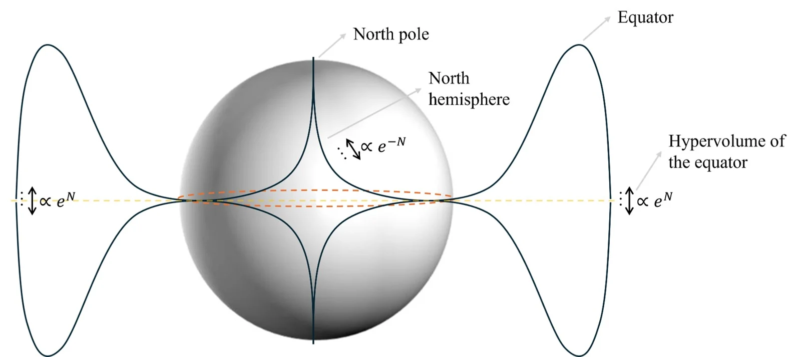
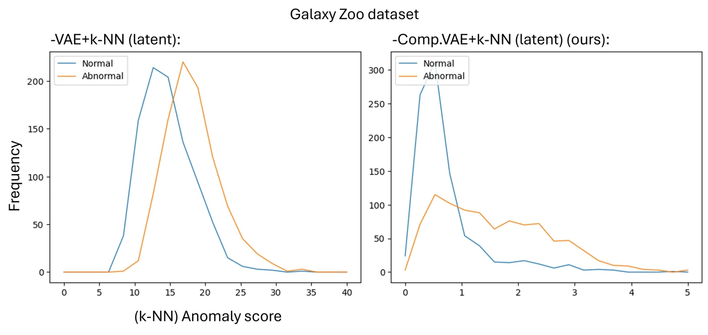
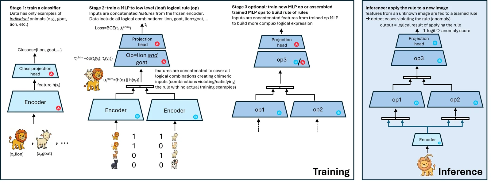
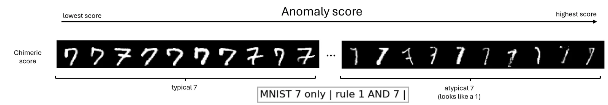
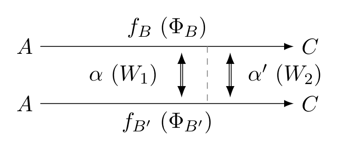
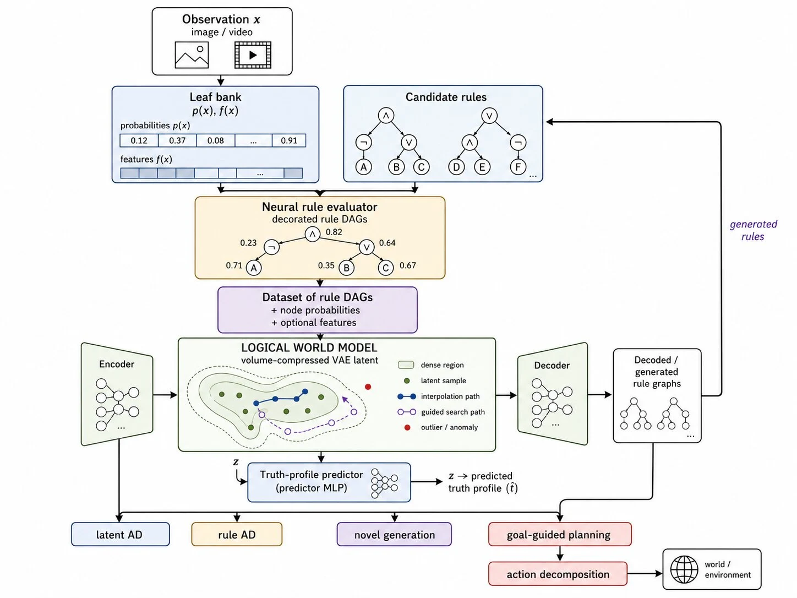

[← Artificial Intelligence](artificial-intelligence.qmd)

Imagine watching a short video of a cyan cube rolling across a table. It hits another object just before the clip ends. Every frame looks ordinary. But suppose the hypothesis we are testing says that if the cyan cube collides, it does so in the first half of the clip. We have just seen a counterexample. A much stranger-looking video in which the cube never collides would satisfy the same implication.

**What does a machine need to represent in order to see the difference?** My work on anomaly detection led me to two ways of asking this question. One concerns the geometry of the space in which observations are compared. The other concerns the concepts and relations that let us say *what happened*. Following the second question eventually leads to a third: how could we judge whether the concepts themselves were well chosen?

The geometry and logical anomaly detection described below have been studied experimentally. The Logic VAE has a synthetic prototype. The witnessed constructions, semantic planning interface, and ontology-search programme describe the direction I am developing from those foundations.

## 1. What makes an observation unusual?

An autoencoder compresses an observation into a latent vector and tries to reconstruct it. Train it on ordinary examples and a tempting prediction follows: an unusual example should be harder to reconstruct. In a chest X-ray experiment from my thesis, a model trained on images labelled “No Finding” could also reconstruct images labelled “Pneumothorax.” Reconstruction error separated the groups about as well as chance. The ability to reproduce much of an image can coexist with insensitivity to the particular feature we care about.

We can instead ask how close a new observation lies to ordinary examples in the *latent space*. This makes the geometry of that space consequential. Consider a high-dimensional standard Gaussian. Its typical draws have similar radii, concentrated near a shell. There is a second, angular effect. Pick an axis: almost all directions lie close to the equator perpendicular to it. The choice of axis was arbitrary. Our picture of the surface of a ball in three dimensions is a poor guide to how densely a finite training set covers that shell.

{fig-alt="A sphere with a shaded equatorial belt and a profile showing concentration near the equator."}

The hyperspherical-coordinate VAE lets us control the radius and several angular coordinates explicitly. Constraining the angular spread reduces the volume occupied by the nominal representations. This gives a simple nearest-neighbour score a chance to separate observations that previously lay at similar distances. There is a trade-off: excessive compression can discard distinctions that reconstruction or generation needs. The setting of interest is where ordinary observations cluster more tightly while retaining useful internal variation.

{fig-alt="Two Galaxy Zoo score histograms compare the baseline VAE and the compressed VAE for ordinary and anomalous galaxies."}

The spin-glass work asks what kind of organization the encoder has learned. Fix the decoder and an observation. The reconstruction term and latent prior define an energy over candidate latent configurations. One diagnostic compares directions assigned to different observations: two aligned directions have a large overlap, while nearly perpendicular directions have an overlap near zero. The *distribution* of these overlaps can reveal partial ordering that is invisible in a single mean reconstruction error. The experiments relate this intermediate regime to improvements in generation and anomaly detection.

There is a useful check on the interpretation of these scores. In a class-split test, the researcher designates one class as anomalous. If that class occupies the interior of the mixture of training classes, its examples can have *smaller* anomaly scores than ordinary examples. The resulting reversal tells us something about the benchmark geometry. The collision example poses a further problem: even a well-behaved distance score gives us no direct way to ask *which expectation the clip violated*.

## 2. How does a scene give evidence for a rule?

Return to the video. Let $A$ mean “the cyan cube collides” and $B$ mean “the cyan cube collides in the first half.” The rule $A\Rightarrow B$ is false precisely when $A$ is true and $B$ is false. A collision halfway through the second half is an anomaly **relative to that rule**. A reader who disagrees with the expectation can inspect it, replace it, and ask a different question of the same video.

Even perfect knowledge of the two marginal probabilities would leave something unresolved. The violation probability is $P(A\wedge\neg B)$, which depends on how the events are related. Here an early collision is itself evidence for a collision. Multiplying scalar probabilities under an independence assumption discards that relationship. A learned evaluator can carry perceptual evidence for both operands into the decision.

I specify the expression as a tree, or a graph when subexpressions are shared. A perceptual encoder supplies visual features and the leaf bank estimates the concepts. In the current trainer the same encoder feature vector is available at each leaf. For every internal node, a small network learns its particular subexpression from its children's features and the negations on the incoming edges. It returns a local truth estimate and a new feature vector. The vector travels upward. The estimate lets us inspect the clause in its own right.

During training, annotated concept values determine an exact Boolean target at each node. Lower subtrees are trained first and frozen when their parent is learned. A matching subtree can therefore be used again. A new parent generally needs its own training, even when both children are familiar. At inference, a new video passes through the assembled graph and we can follow the estimates from the leaves to the root.

{fig-alt="Diagram of perceptual training, local gate training, reuse within a larger expression, and inference."}

## 3. How can it learn a violation it has never seen?

Suppose every training clip with a cyan-cube collision has an early one. The implication is always satisfied. A classifier that always answers “true” fits those examples perfectly. Yet the collection may contain plenty of evidence for each side of the missing combination: clips in which a collision occurs, and other clips in which no early collision occurs.

**Chimera training** uses that distinction. Take the left operand's feature from a clip with $A=1$, and the right operand's feature from another with $B=0$. Keep the truth label that belongs to each operand. The training target for this pair is now exactly $1\Rightarrow 0=0$. The construction also works higher in the graph, where an operand can be the learned feature of an entire clause. It creates a labelled pair of features; it makes no claim that the pair depicts a physically realizable clip. It needs each required operand value to occur somewhere. At test time, both operands come from the same observation again.

A small image experiment makes the effect visible. Train a conjunction on the concepts “one” and “seven,” then ask which real handwritten sevens score highest. Some sevens carry visual evidence for both digits even though each has a single annotated class.

{fig-alt="A row of handwritten sevens ordered from low to high learned evidence for the conjunction of one and seven."}

The role of dependence also shows up in the video experiments. On the tested static CLEVR rules, composing independent probabilities was already near perfect. On the event-rich CLEVRER rules, mean anomaly AUROC rose from 0.750 under independent composition to 0.833 with the learned evaluator. The point of the comparison is that the value of retaining features depends on the relations the task actually contains.

## 4. What if the formula is the unknown?

So far the question has been “given this rule, how well does the observation support it?” Reverse the experiment. **Fix one video and vary the reasoning.** For each rule we evaluate, attach the truth estimate of every node to its place in the tree. Two trees can have similar root scores while relying on different intermediate claims. The training object is now a reasoning structure together with this whole truth profile.

The **Logic VAE** is intended to learn a space of such objects for a fixed vocabulary. An encoder maps examples into a latent space. Sampling, interpolating, or searching in that space provides candidate latent codes. The decoder turns a code back into an explicit rule that a person can read. A probability predictor estimates the profile associated with the candidate and the observation. This is where the larger system can propose and score a composition for which no individual subtree evaluator was trained.

These roles lead to two separate tests. Does decoding yield a well-formed, genuinely held-out structure? Do the predicted values agree with a reference evaluation of *that structure on that observation*? An attractive rule with an inaccurate root estimate fails the second test. Good root predictions that conceal errors in the clauses also matter if someone plans to use the reasoning as an explanation.

The current conditional prototype uses synthetic probability profiles computed with independent-event formulas. Its probability head reads decoder states informed by the latent code, leaf probabilities, and the decoded prefix. In the intended perceptual experiment, the training profiles come from the feature-aware evaluator. Fixing one video first isolates variation across rules. Extending the model across videos requires conditioning that preserves the evidence needed to distinguish them, including cases where similar leaf probabilities hide different dependencies.

## 5. When are two routes through an implication related?

A rule can say more than that $A$ implies $C$. It can record *how* the reasoning goes from one to the other. Choose two intermediate concepts, $B$ and $B'$, and form the syntactic paths

$$
\Phi_B=(A\Rightarrow B)\wedge(B\Rightarrow C),\qquad
\Phi_{B'}=(A\Rightarrow B')\wedge(B'\Rightarrow C).
$$

Replacing both by $A\Rightarrow C$ would erase the choice of intermediate. Keeping the paths lets us ask a new question: **what witnesses their agreement?** In my homotopical construction a witness is itself an explicit atom, drawn from a dedicated vocabulary. The first witnessed block is

$$
P_1^k=(\Phi_B\Leftrightarrow W_k)\wedge(\Phi_{B'}\Leftrightarrow W_k).
$$

Both paths are compared with the *same* $W_k$. Choosing another witness gives a second way to relate the very same pair of paths. The drawing below shows the two paths horizontally and the two witnesses between them.

{width=75% fig-alt="Parallel paths from A to C, with witnesses alpha and alpha prime relating them."}

Now take two lower blocks, indexed by $k_1$ and $k_2$. They may differ in their earlier witnesses. One new witness relates them at the next level:

$$
P_{\ell+1}^{k}
=(P_\ell^{k_1}\Leftrightarrow W_k)\wedge(P_\ell^{k_2}\Leftrightarrow W_k),
\qquad \ell\geq 1.
$$

This is the sense in which the construction is higher-dimensional. First we have paths, then witnesses between paths, then witnesses between witnessed relations. Formula depth alone would count additional connectives without telling us *what kinds of objects* they relate. There is also a distinction between the structure we encode and the evidence that supports it. Under Boolean semantics the first block can be true when both paths and the witness are false. Reading a block as a positively supported explanation requires inspecting the witness and path values themselves.

## 6. How would a logical world model use these objects?

Suppose a vocabulary distinguishes the current state, actions one could take, and later consequences. A goal can then be expressed as a formula. Holding the observed state fixed, we can ask which candidate action the model expects to make that goal more likely. A generative model can also estimate how plausible the proposed configuration is. Together these give us two reasons to examine a candidate: the clauses that support the goal, and whether the configuration resembles ones for which the system has evidence.

{fig-alt="World-model schematic with a leaf bank, rule evaluator, encoder, latent predictor, decoder and generated rules."}

For example, a manipulation system might ask whether releasing a grasp now would leave an object supported. Changing an action atom provides a way to *pose* that question. Evidence from executed actions and their outcomes is what would justify interpreting the answer as a prediction of an intervention. Chimera pairs provide supervision for logical combinations; they cannot supply that evidence about the world. The proposed planning interface would expose which rules support a choice and allow their predictions to be tested against what subsequently happens.

## 7. How should a machine choose its concepts?

Everything above presupposes a vocabulary. To see what is at stake in choosing one, consider a small world with two routes between the same states: $A\to B\to C$ and $A\to D\to C$. Suppose $B$ and $D$ look similar. One candidate description distinguishes them, while another merges them. The experiment can be constructed so that both descriptions predict one-step observations equally well. Yet merging the intermediates collapses the two routes. A system can then lose the distinction needed even to *ask* how those routes are related.

In this programme an **ontology** specifies both the concepts available to a reasoning system and the abstraction map that connects observations to them. Changing the ontology changes what counts as a path, which witnesses can be distinguished, and which rules a generative model can express. We can therefore compare ontologies by the reasoning systems they support. A useful vocabulary might explain many stable consequences using relatively few concepts and relations. A larger vocabulary earns its cost only if its distinctions do useful work.

My proposed first test is a benchmark of **Hidden Higher-Structure Worlds**. The experimenter knows the states, paths, and higher relations by construction. The learner receives observations. Candidate abstractions can tie on local prediction while preserving different global structure. We can then ask whether measurements of the induced reasoning spaces, such as connected components or persistent cycles across evidence thresholds, help predict robustness or transfer beyond what prediction, complexity, and compression already tell us. If they add nothing on held-out worlds, that is evidence against using them as selection criteria.

A later meta-world-model would learn from completed ontology trials to estimate which concept systems deserve further investigation. The distinction from the Logic VAE is simple: the VAE searches for *reasonings within a vocabulary*. Ontology search changes *the vocabulary in which those reasonings can exist*. This brings us back to the opening question. Two descriptions may agree about what happens next. What else can each one explain, and what experiment would reveal a difference?

## Further reading

- [Improving VAE generation with hyperspherical coordinates](https://arxiv.org/abs/2507.15900) and [anomaly detection from hypervolume-compressed latent space](https://arxiv.org/abs/2601.18823)
- [Phase structure and nested ordering in high-dimensional autoencoder latent spaces](https://arxiv.org/abs/2606.02600)
- [Testing the Test: Score-Direction Instability in Class-Split Anomaly Detection](https://arxiv.org/abs/2606.02601)
- [When Rule Violations Are Rare: Chimera Training for Logical Anomaly Detection](https://arxiv.org/abs/2605.26171)
