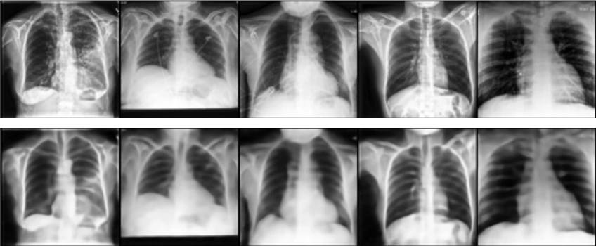
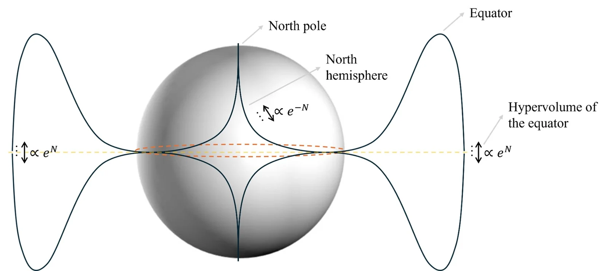
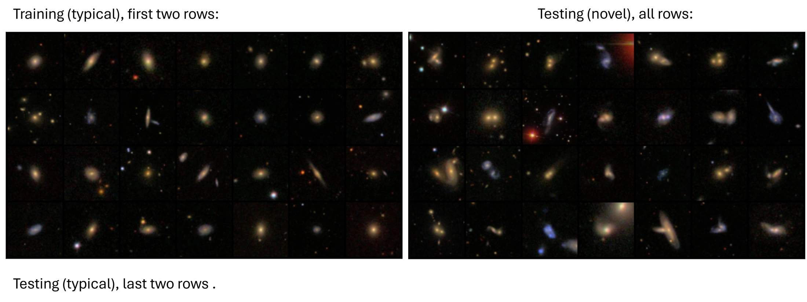
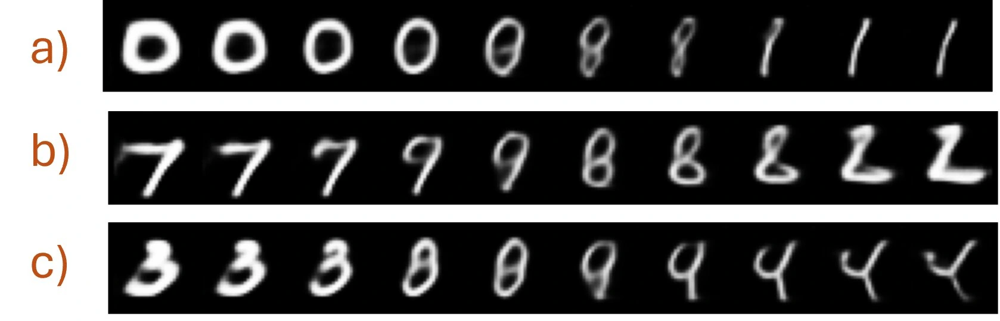
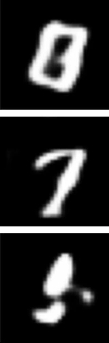
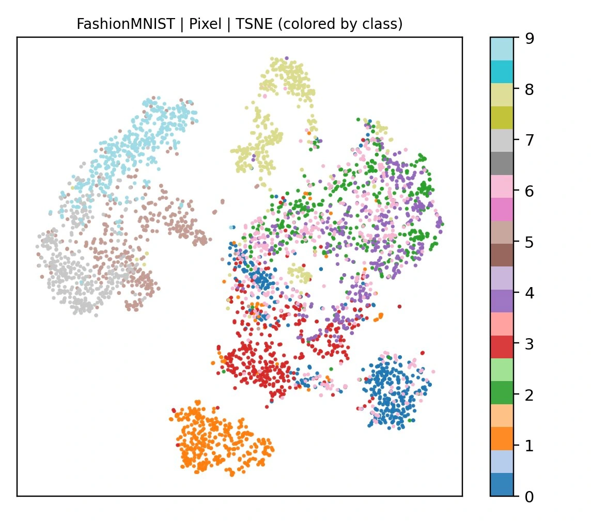
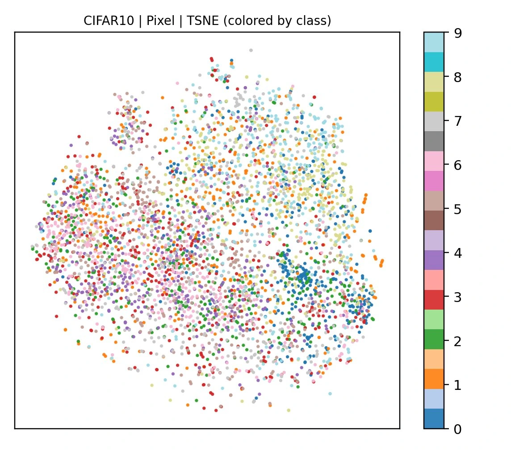
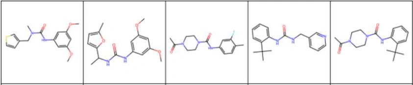
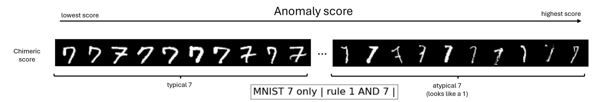
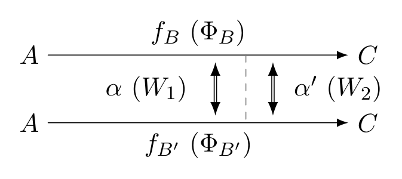

[← Artificial Intelligence](artificial-intelligence.qmd)

A model can reconstruct an image faithfully and still miss what makes it unusual. It can arrange observations into a useful geometric space without saying which expectation they violate. And it can evaluate a supplied rule without being able to propose a new one. My research follows these questions from **the geometry of generative models** to **anomaly detection** and **explicit reasoning structures**.

```{=html}
<nav class="ai-route" aria-label="Explore the research">
<a href="#latent-geometry"><span>01</span> Geometry &amp; anomalies</a>
<a href="#logical-anomalies"><span>02</span> Logical violations</a>
<a href="#generative-reasoning"><span>03</span> Generative reasoning</a>
</nav>
```

{fig-alt="Standard and compressed VAE latent representations of Galaxy Zoo, with encoder and decoder diagrams below." loading="eager"}

The main body of my PhD studies high-dimensional VAE representations: how to organize them, how to sample from them, and how to use their distances to detect anomalies. Logical anomaly detection extends that work by making the expectation itself explicit. The Logic VAE brings the two lines together, using a generative latent space for rules and their truth profiles.

## 1. Latent geometry, generation, and anomaly detection {#latent-geometry}

```{=html}
<nav class="ai-topic-links" aria-label="Topics in latent geometry">
<a href="#reconstruction">Reconstruction</a><a href="#compression">Compression</a><a href="#image-anomalies">Image AD</a><a href="#generation">Generation</a><a href="#latent-phases">Latent phases</a><a href="#benchmark-geometry">Benchmarks</a><a href="#molecular-anomalies">Molecules</a>
</nav>
```


### When reconstruction misses the anomaly {#reconstruction}

An autoencoder maps an observation to a latent vector and learns to reconstruct it. Train it only on ordinary examples and a tempting prediction follows: an unusual example should be harder to reconstruct. But an encoder and decoder can learn features that also reproduce observations outside the training distribution.

In the CheXpert chest X-ray experiment below, a model trained on images labelled “No Finding” also reconstructs images labelled “Pneumothorax.” Reconstruction error separated the groups about as well as chance. Much of the image can be preserved while the particular distinction we care about remains inaccessible to that score.

```{=html}
<div class="ai-pair">
<figure><h4>No Finding</h4><figcaption>Originals above; reconstructions below.</figcaption></figure>
<figure><h4>Pneumothorax</h4><figcaption>The same model also reconstructs the anomalous group.</figcaption></figure>
</div>
```

This motivates a second question: **where does an observation lie relative to the training examples in latent space?** A nearest-neighbour detector can ask that question, but its usefulness now depends on the geometry learned by the encoder.

### Changing the geometry without reducing the dimension {#compression}

Our intuition from a two- or three-dimensional Gaussian is misleading in high dimension. Typical samples from $\mathcal N(0,I_n)$ have radii close to $\sqrt n$. There is also an angular effect: relative to any fixed axis, most directions lie near its perpendicular equator. A finite dataset can be sparse on this large shell even though the radii and angles concentrate sharply.

{fig-alt="A sphere with a shaded equatorial belt illustrating concentration of measure." width=80%}

My **hyperspherical-coordinate VAE** makes the radius and angular coordinates explicit. The regularizer controls their batch statistics, allowing the encoder to move nominal observations away from the high-volume equatorial regimes and reduce the region they occupy. This changes the arrangement of the representations while retaining the latent dimension. It also allows control over the angular hierarchy, beyond the single directional concentration of the von Mises–Fisher comparison.

Reconstruction opposes complete collapse: the decoder still needs enough variation to distinguish observations. The useful question is how to make the occupied region compact **while preserving the internal structure needed for a task**.

<details class="ai-details">
<summary>The geometric idea in coordinates</summary>

For $z\in\mathbb R^n$, write its hyperspherical coordinates as $(r,\varphi_1,\ldots,\varphi_{n-1})$. The Euclidean volume element contains

$$
\mathrm dV=r^{n-1}\prod_{j=1}^{n-2}(\sin\varphi_j)^{n-j-1}\,\mathrm dr\,\mathrm d\varphi_1\cdots\mathrm d\varphi_{n-1}.
$$

The powers of the sines make angular location consequential in high dimension. The method regularizes the means and spreads of the angular coordinates, expressed through their cosines, alongside the radial statistics. The reconstruction term balances this drive toward concentration. The [method paper](https://arxiv.org/abs/2507.15900) gives the full training objective.

</details>

### Detecting anomalies in images {#image-anomalies}

**Training on nominal images alone.** Galaxy Zoo and Mars Rover Mastcam provide two applications without normal-subclass labels in representation training. After training, the nominal latent means form a reference set. A test image is scored by its distance to nearby reference examples. Compression changes that reference geometry; the scoring principle remains the same.

```{=html}
<figure class="ai-gallery">
<h4>Looking at the galaxies</h4>

<figcaption>Galaxy Zoo images from the VAE anomaly-detection study. Left: nominal galaxies, with training examples in the first two rows and test examples in the last two. Right: anomalous test galaxies, selected using the volunteer “odd” annotation. <a href="https://arxiv.org/html/2601.18823v1#as1_S4.F8">Source: supplementary Figure 8.</a></figcaption>
</figure>
```

{fig-alt="Nominal and anomalous Galaxy Zoo score distributions before and after compression."}

| Dataset | Standard VAE + kNN AUROC | Compressed VAE + kNN AUROC |
|:--|--:|--:|
| Mars Rover Mastcam | 0.664 | **0.764** |
| Galaxy Zoo | 0.741 | **0.789** |

These are the thesis's matched VAE comparisons. The improvement in overall ranking does not imply improvement at every operating point: Galaxy Zoo FPR95 changes from 0.77 to 0.80, whereas Mastcam changes from 0.66 to 0.62. The [AD paper](https://arxiv.org/abs/2601.18823) reports the other detectors and metrics.

**When the normal classes are known.** A separate set of experiments uses ID class labels to organize different class clusters. Here the difficult cases are nearby alternatives: tench versus goldfish, or an English versus a Welsh springer spaniel. The experiments include CIFAR-10 versus CIFAR-100 and Imagenette versus semantically close ImageNet classes.

```{=html}
<div class="ai-motion" data-paired-video>
<div class="ai-pair">
<figure><h4>Single-direction concentration · vMF</h4><video controls loop muted playsinline preload="metadata" poster="../assets/ai/visuals/latent-vmf-poster.webp" aria-label="Training evolution of nominal Imagenette representations for the von Mises–Fisher comparison"><source src="../assets/ai/visuals/latent-vmf.mp4" type="video/mp4"></video></figure>
<figure><h4>Hyperspherical compression</h4><video controls loop muted playsinline preload="metadata" poster="../assets/ai/visuals/latent-compressed-poster.webp" aria-label="Training evolution of nominal Imagenette representations for the compressed VAE"><source src="../assets/ai/visuals/latent-compressed.mp4" type="video/mp4"></video></figure>
</div>
<div class="ai-media-controls" hidden><button type="button" class="ai-button" data-play-pair>Play both training animations</button><button type="button" class="ai-button" data-reset-pair>Restart animations</button></div>
<p class="ai-caption">Animations of the full training process from the final seminar. Both show coordinate-averaged views of high-dimensional Imagenette representations, with colours distinguishing the nominal ID classes. Only nominal samples are displayed here. The vMF comparison concentrates one direction; the proposed prescription controls the full angular hierarchy. Press play to follow how the representations develop during training.</p>
</div>
```

{fig-alt="Static Imagenette latent representations including both coloured nominal classes and grey near-OOD anomalies."}

### What changes for generation? {#generation}

Reconstructing an encoded image and decoding a newly sampled latent vector are different tests. A decoder can work well near the encoded observations while behaving poorly in other regions visited by its sampling distribution. This is especially visible when we give a relatively simple VAE a large latent space.

{fig-alt="MNIST originals, reconstructions and generated digits compared between standard and compressed VAEs."}

The thesis studies both generation and the routes between encoded examples. The sequences below decode intermediate latent locations for three digit pairs. They make it possible to inspect the continuity and recognizability of the outputs, rather than judging a representation only by reconstruction error.

```{=html}
<div class="ai-interpolation" data-interpolation>
<div class="ai-pair">
<figure><h4>Standard VAE</h4></figure>
<figure><h4>Compressed VAE</h4></figure>
</div>
<div class="ai-scrubber" hidden>
<p class="ai-eyebrow">Inspect the saved interpolation steps</p>
<div class="ai-frame-pair">
<figure><figcaption>Standard VAE</figcaption></figure>
<div class="ai-path-labels" aria-hidden="true"><span>0 → 1</span><span>7 → 2</span><span>3 → 4</span></div>
<figure><figcaption>Compressed VAE</figcaption></figure>
</div>
<label for="interpolation-step">Saved step <output id="interpolation-position" for="interpolation-step">1 of 10</output></label>
<input id="interpolation-step" type="range" min="0" max="9" value="0" step="1" aria-describedby="interpolation-note">
</div>
<p class="ai-caption" id="interpolation-note">Three paths: 0 → 1, 7 → 2, and 3 → 4. Move the slider to compare the ten saved steps from the thesis experiment.</p>
</div>
```

The comparison does not mean that the standard VAE had no class structure. In this MNIST experiment, kNN classification in the full latent space was already strong in both models, and was higher without compression (0.95 versus 0.88). Geometry that helps sampling or a particular anomaly score need not maximize every other task.

<details class="ai-details">
<summary>Reconstruction, generation, and the sampling distribution</summary>

The MNIST compressed model samples from an **effective prior** fitted to the embedding's empirical mean and covariance; the reported experiment estimated those statistics from the embedded test set. Its generated samples therefore illustrate the combined compression-and-sampling prescription, rather than unchanged standard-Gaussian sampling.

For CIFAR-10 and CelebA, the thesis examines the trade-off across latent sizes and regularization strengths. Reconstruction is measured by MSE. **Self-FID** compares generated images with reconstructed test images, so it measures agreement with the decoder's reconstructed distribution rather than conventional FID against the original images.

{fig-alt="CIFAR-10 MSE versus self-FID curves with example reconstructed and generated images."}

</details>

[Read the generation paper →](https://arxiv.org/abs/2507.15900){.card-link}

### How much compression is useful? {#latent-phases}

Compression is not a prescription to make every observation identical. Too little organization leaves a diffuse representation; too much can erase distinctions needed by the decoder or detector. In the experiments, useful behaviour appears in an intermediate, partially ordered regime.

{fig-alt="Galaxy Zoo detection and latent geometry compared across overcompressed, intermediate and undercompressed regimes."}

The spin-glass work develops a way to study this organization through **observables of the latent representations**. Fix a decoder and an observation: reconstruction and regularization define an energy over candidate latent configurations. Directions assigned to different observations can be compared through their overlaps, while coordinate coarse-graining tests which structures remain visible as detail is removed.

Angular histograms provide another view. Instead of showing two projected axes, they display the distribution of every hyperspherical coordinate. The heatmaps below illustrate how the regularizer's preferred direction changes the hierarchy of angular organization.

{fig-alt="Three heatmaps showing distributions of hyperspherical angular coordinates under different preferred field directions."}

The phase diagnostics ask more than whether a cloud looks clustered. Both standard and compressed models can contain class information, but differ in the stability of that organization under coarse-graining and in its usefulness for generation or distance-based detection. The interpretation concerns finite trained systems, with the diagnostics checked against their task performance.

[Read the latent-phase study →](https://arxiv.org/abs/2606.02600){.card-link}

### When the benchmark changes the answer {#benchmark-geometry}

A common AD test declares one class anomalous and trains on all the others. This creates a semantic distinction, but it does not guarantee that the held-out class will be far from the normal mixture. If it lies in the mixture's interior, an ordinary distance-based score can rank its examples as *less* unusual than the designated normal examples.

```{=html}
<div class="ai-pair">
<figure><h4>FashionMNIST</h4></figure>
<figure><h4>CIFAR-10</h4></figure>
</div>
```

These projections illustrate contrasting degrees of class overlap; the study evaluates the effect using scores in the underlying representations. A detector with a fixed score direction can move from a useful ranking to chance or inversion as the held-out class changes. This makes the geometry of the evaluation protocol part of the scientific question.

<details class="ai-details">
<summary>See the per-class score reversals</summary>

{fig-alt="Per-class CIFAR-10 AUROC curves crossing the chance line for different anomaly detectors."}

</details>

[Read “Testing the Test” →](https://arxiv.org/abs/2606.02601){.card-link}

### From images to molecules {#molecular-anomalies}

Can the same approach expose structure associated with a much different kind of property? In an extension beyond the thesis's image experiments, I apply hyperspherical compression to an NP-VAE molecular model trained on **random ZINC molecules**, without docking scores, docking poses, or protein-target information in its training objective.

The evaluation uses molecules selected from the favourable and unfavourable extremes of an NSP14 docking-score collection. Each group is compared separately with held-out random ZINC. The question is whether an unsupervised molecular geometry makes membership in those externally selected populations accessible through a simple latent-distance score.

```{=html}
<figure class="ai-gallery ai-molecule-examples">
<h4>Nominal · random ZINC</h4>

<h4>Best docking</h4>

<h4>Worst docking</h4>

<figcaption>The first row from each population in the molecular-results collection. These are molecular structures, not a ranking by latent anomaly score.</figcaption>
</figure>
```

The following three views show the **same nominal ZINC island in red**. The grey population changes from the low-docking subset, closer to that island, to the high-docking subset, farther away. In this experiment, the better-docking molecules are more specialized relative to random ZINC, and that distinction is visible in a representation learned without docking supervision. “High docking” here means better docking ability, rather than a numerically higher raw docking score.

```{=html}
<div class="ai-motion" data-paired-video data-play-label="Play all three comparisons" data-pause-label="Pause all three comparisons">
<div class="ai-triptych">
<figure><h4>View a</h4><video controls loop muted playsinline preload="metadata" poster="../assets/ai/visuals/molecular-view-a-low.webp" aria-label="View a: low- and high-docking molecular populations alternate around a fixed nominal ZINC reference"><source src="../assets/ai/visuals/molecular-view-a.mp4" type="video/mp4"><a href="../assets/ai/visuals/molecular-view-a.mp4">Download view a.</a></video><figcaption>Inspect stills: <a href="../assets/ai/visuals/molecular-view-a-low.webp">low docking</a> · <a href="../assets/ai/visuals/molecular-view-a-high.webp">high docking</a>.</figcaption></figure>
<figure><h4>View b</h4><video controls loop muted playsinline preload="metadata" poster="../assets/ai/visuals/molecular-view-b-low.webp" aria-label="View b: low- and high-docking molecular populations alternate around a fixed nominal ZINC reference"><source src="../assets/ai/visuals/molecular-view-b.mp4" type="video/mp4"><a href="../assets/ai/visuals/molecular-view-b.mp4">Download view b.</a></video><figcaption>Inspect stills: <a href="../assets/ai/visuals/molecular-view-b-low.webp">low docking</a> · <a href="../assets/ai/visuals/molecular-view-b-high.webp">high docking</a>.</figcaption></figure>
<figure><h4>View c</h4><video controls loop muted playsinline preload="metadata" poster="../assets/ai/visuals/molecular-view-c-low.webp" aria-label="View c: low- and high-docking molecular populations alternate around a fixed nominal ZINC reference"><source src="../assets/ai/visuals/molecular-view-c.mp4" type="video/mp4"><a href="../assets/ai/visuals/molecular-view-c.mp4">Download view c.</a></video><figcaption>Inspect stills: <a href="../assets/ai/visuals/molecular-view-c-low.webp">low docking</a> · <a href="../assets/ai/visuals/molecular-view-c-high.webp">high docking</a>.</figcaption></figure>
</div>
<div class="ai-media-controls" hidden><button type="button" class="ai-button" data-play-pair>Play all three comparisons</button><button type="button" class="ai-button" data-reset-pair>Return to low docking</button></div>
<p class="ai-caption">Three perspectives of the compressed molecular representation. Each alternates the observed low- and high-docking populations every three seconds, keeping its axes, viewpoint, and nominal reference in place. Red: nominal ZINC. Grey: docking-selected molecules. These coarse-grained views illustrate the geometry; anomaly scores use distances in the full 256-dimensional latent space.</p>
</div>
```

In a representative matched comparison, compressed latent kNN reaches AUROC **0.892** for the favourable-docking subset and **0.787** for the unfavourable subset, compared with **0.780** and **0.653** for Morgan-fingerprint/Tanimoto kNN. The corresponding uncompressed-VAE scores are **0.722** and **0.635**. These are individual matched results, rather than averages over runs.

{fig-alt="ROC curves comparing fingerprints and standard and compressed molecular latent representations for favourable and unfavourable docking subsets."}

The result concerns **docking-related population structure accessible without docking supervision**. Docking is a three-dimensional, target-dependent scoring task, yet molecular differences associated with its selected extremes become accessible through a representation trained on molecular structure alone. Compression improves that accessibility beyond the tested fingerprint baseline. The low-to-high comparisons above make the observed direction concrete: the better-docking population lies farther from the random-ZINC reference island.

There is a second connection to the image experiments: continued training can improve molecular reconstruction while removing the AD advantage. Preserving information for decoding and arranging it for a useful distance score are related but different objectives. This molecular work is ongoing; its representative results currently concern one docking collection and target.

## 2. Learning to recognise logical violations {#logical-anomalies}

The geometric approach asks where an observation lies relative to a reference population. A different kind of question begins with an explicit expectation: **which relation should hold, and does this observation support it?** An ordinary-looking scene can violate that expectation, while a visually unusual scene may satisfy it.

Watch the two short videos below. In both, a cube collides with a blue object during the first half of the clip. Yet only one satisfies the rule we are testing: **a cube–blue-object collision must be preceded by an entry event, and an entry followed by a collision must lead to a collision in the first half.** In the first video, the colliding objects are already present at the start. In the second, the yellow cube enters the scene and then collides with the blue sphere. The difference lies in the sequence of events, even though both scenes look ordinary.

Let $A$ denote a cube–blue-object collision, $B$ an entry followed by a collision for that pair, and $C$ a collision of that pair in the first half. The rule is

$$
(A\Rightarrow B)\wedge(B\Rightarrow C).
$$

Here “cube” and “blue” select the two participants; they do not require the cube itself to be blue. The truth values below follow the annotations used in the experiment.

```{=html}
<div class="clevr-video-pair" style="display: grid; grid-template-columns: repeat(auto-fit, minmax(min(100%, 280px), 1fr)); gap: 1.25rem; margin: 1.5rem 0;">
<figure style="margin: 0;">
<video controls loop muted playsinline preload="metadata" width="480" height="320" poster="../assets/ai/clevrer/chain-violation.jpg" aria-label="CLEVRER chain-rule violation: a cube and a blue object collide without a preceding entry event" style="display: block; width: 100%; height: auto;">
<source src="../assets/ai/clevrer/chain-violation.mp4" type="video/mp4">
<a href="../assets/ai/clevrer/chain-violation.mp4">Download the rule-violation video.</a>
</video>
<figcaption><strong>Rule violated.</strong> The blue cube and blue cylinder are present from the start and collide in the first half. The entry-then-collision event is absent, so the first implication fails. Ground truth: A = true, B = false, C = true.</figcaption>
</figure>
<figure style="margin: 0;">
<video controls loop muted playsinline preload="metadata" width="480" height="320" poster="../assets/ai/clevrer/chain-satisfaction.jpg" aria-label="CLEVRER chain-rule satisfaction: a yellow cube enters and collides with a blue sphere in the first half" style="display: block; width: 100%; height: auto;">
<source src="../assets/ai/clevrer/chain-satisfaction.mp4" type="video/mp4">
<a href="../assets/ai/clevrer/chain-satisfaction.mp4">Download the rule-satisfaction video.</a>
</video>
<figcaption><strong>Rule satisfied.</strong> The yellow cube enters and collides with the blue sphere in the first half. Both implications hold. Ground truth: A = true, B = true, C = true.</figcaption>
</figure>
</div>
```

*CLEVRER examples from my logical anomaly-detection experiments. Press play to watch each clip; playback loops until paused. Each full clip lasts about five seconds.*

### How does a scene give evidence for a rule? {#rule-evaluation}

Return to the two videos. The first implication, $A\Rightarrow B$, is false precisely when the collision occurs but the entry-then-collision event is absent. The second, $B\Rightarrow C$, tests whether an entry-then-collision event is accompanied by a collision in the first half. Their conjunction requires both implications to hold. The first clip is therefore an anomaly **relative to that rule**. A reader who disagrees with the expectation can inspect it, replace it, and ask a different question of the same video.

A third clip illustrates a different compound rule. For a sphere–cylinder pair, require that a collision implies **both** a collision in the first half **and** an entry followed by a collision:

$$
A_{\rm sc}\Rightarrow(C_{\rm sc}\wedge B_{\rm sc}).
$$

```{=html}
<figure style="max-width: 480px; margin: 1.5rem auto;">
<video controls loop muted playsinline preload="metadata" width="480" height="320" poster="../assets/ai/clevrer/compound-violation.jpg" aria-label="CLEVRER compound-rule violation: a sphere and cylinder collide after the halfway point" style="display: block; width: 100%; height: auto;">
<source src="../assets/ai/clevrer/compound-violation.mp4" type="video/mp4">
<a href="../assets/ai/clevrer/compound-violation.mp4">Download the compound-rule video.</a>
</video>
<figcaption><strong>Compound rule violated.</strong> The sphere–cylinder collision and the entry-then-collision event are present, but the first-half collision condition is false. One failed conjunct is enough to violate the rule. Ground truth: A<sub>sc</sub> = true, B<sub>sc</sub> = true, C<sub>sc</sub> = false.</figcaption>
</figure>
```

Even perfect knowledge of the marginal probabilities would leave something unresolved. For the first implication of the cube–blue-object rule, the violation probability is $P(A\wedge\neg B)$, which depends on how the events are related. Here an entry followed by a collision is itself evidence for a collision. Multiplying scalar probabilities under an independence assumption discards that relationship. A learned evaluator can carry perceptual evidence for both operands into the decision.

I specify the expression as a tree, or a graph when subexpressions are shared. A perceptual encoder supplies visual features and the leaf bank estimates the concepts. In the current trainer the same encoder feature vector is available at each leaf. For every internal node, a small network learns its particular subexpression from its children's features and the negations on the incoming edges. It returns a local truth estimate and a new feature vector. The vector travels upward. The estimate lets us inspect the clause in its own right.

During training, annotated concept values determine an exact Boolean target at each node. Lower subtrees are trained first and frozen when their parent is learned. A matching subtree can therefore be used again. A new parent generally needs its own training, even when both children are familiar. At inference, a new video passes through the assembled graph and we can follow the estimates from the leaves to the root.

{fig-alt="Diagram of perceptual training, local gate training, reuse within a larger expression, and inference."}

### How can it learn a violation it has never seen? {#chimera-training}

Suppose every training clip with a cube–blue-object collision also has the corresponding entry-then-collision event. The implication is always satisfied. A classifier that always answers “true” fits those examples perfectly. Yet the collection may contain plenty of evidence for each side of the missing combination: clips in which a collision occurs, and other clips in which the entry-then-collision event is absent.

**Chimera training** uses that distinction. Take the left operand's feature from a clip with $A=1$, and the right operand's feature from another with $B=0$. Keep the truth label that belongs to each operand. The training target for this pair is now exactly $1\Rightarrow 0=0$. The construction also works higher in the graph, where an operand can be the learned feature of an entire clause. It creates a labelled pair of features; it makes no claim that the pair depicts a physically realizable clip. It needs each required operand value to occur somewhere. At test time, both operands come from the same observation again.

A small image experiment makes the effect visible. Train a conjunction on the concepts “one” and “seven,” then ask which real handwritten sevens score highest. Some sevens carry visual evidence for both digits even though each has a single annotated class.

{fig-alt="A row of handwritten sevens ordered from low to high learned evidence for the conjunction of one and seven."}

### Why train an evaluator instead of composing probabilities? {#independent-correlated}

If the relevant events are independent, their individual truth probabilities contain everything needed to compose them. For example, writing $p_A=P(A)$ and $p_B=P(B)$ gives

$$
P(A\wedge B)=p_Ap_B,\qquad
P(A\Rightarrow B)=1-p_A(1-p_B).
$$

In that regime, a trained gate need not improve on the appropriate algebraic formula. The tested static **CLEVR** rules illustrate this: independent probability composition was already near perfect. Learning a neural evaluator is useful when there is additional joint information to recover, rather than simply to reproduce an available formula.

**CLEVRER** makes the distinction sharper. Events share objects and are linked through time: an entry followed by a collision entails a collision, and related clauses can describe different aspects of the same interaction. In general, the exact probability of an implication is

$$
P(A\Rightarrow B)=1-P(A\wedge\neg B)
                 =1-P(A)+P(A\wedge B).
$$

The joint term $P(A\wedge B)$ cannot be recovered from the two marginals alone without an assumption about dependence. For example, $p_A=p_B=1/2$ gives an implication probability of $3/4$ under independence, but $1$ if the events always coincide. The individual probabilities are identical; their relationship changes the answer.

This is why the evaluator passes **features as well as truth estimates** up the expression. Those features retain evidence about the shared scene that a single scalar per operand can discard. Local Boolean supervision and chimera training teach each node how to use that evidence, while the meaning of conjunction and implication remains unchanged. In the event-rich CLEVRER experiments, mean anomaly AUROC rose from **0.750** with independent composition to **0.833** with the learned evaluator. The contrast with CLEVR identifies the intended advantage: handling relations for which independent composition leaves out useful information.

## 3. Generating reasoning structures {#generative-reasoning}

The evaluator asks whether an observation supports a supplied rule. The next step is to make reasoning structures themselves objects of generative modelling. This part brings the compression VAE and logical evaluation together, then develops witnessed relations, world models, and ontology search. The generative work is ongoing; the planning and ontology-search sections describe the broader research programme.

### Generating rules and their truth profiles {#logic-vae}

So far the question has been “given this rule, how well does the observation support it?” Reverse the experiment. **Fix one video and vary the reasoning.** For each rule we evaluate, attach the truth estimate of every node to its place in the tree. Two trees can have similar root scores while relying on different intermediate claims. The training object is now a reasoning structure together with this whole truth profile.

The **Logic VAE** learns a space of such objects for a fixed vocabulary. The compression VAE developed above is also used in this line of work: its role is now to organize a generative space of reasoning structures and truth profiles. An encoder maps examples into a latent space. Sampling, interpolating, or searching in that space provides candidate latent codes. The decoder turns a code back into an explicit rule that a person can read. A probability predictor estimates the profile associated with the candidate and the observation. This is where the larger system can propose and score a composition for which no individual subtree evaluator was trained.

<!-- Additional Logic VAE result galleries belong here: decoded graphs, truth profiles, and interpolation. -->

These roles lead to two separate tests. Does decoding yield a well-formed, genuinely held-out structure? Do the predicted values agree with a reference evaluation of *that structure on that observation*? An attractive rule with an inaccurate root estimate fails the second test. Good root predictions that conceal errors in the clauses also matter if someone plans to use the reasoning as an explanation.

The current conditional prototype uses synthetic probability profiles computed with independent-event formulas. Its probability head reads decoder states informed by the latent code, leaf probabilities, and the decoded prefix. In the intended perceptual experiment, the training profiles come from the feature-aware evaluator. Fixing one video first isolates variation across rules. Extending the model across videos requires conditioning that preserves the evidence needed to distinguish them, including cases where similar leaf probabilities hide different dependencies.

### Relating different reasoning paths {#witnessed-relations}

A rule can say more than that $A$ implies $C$. It can record *how* the reasoning goes from one to the other. Choose two intermediate concepts, $B$ and $B'$, and form the syntactic paths

$$
\Phi_B=(A\Rightarrow B)\wedge(B\Rightarrow C),\qquad
\Phi_{B'}=(A\Rightarrow B')\wedge(B'\Rightarrow C).
$$

Replacing both by $A\Rightarrow C$ would erase the choice of intermediate. Keeping the paths lets us ask a new question: **what witnesses their agreement?** In my homotopical construction a witness is itself an explicit atom, drawn from a dedicated vocabulary. The first witnessed block is

$$
P_1^k=(\Phi_B\Leftrightarrow W_k)\wedge(\Phi_{B'}\Leftrightarrow W_k).
$$

Both paths are compared with the *same* $W_k$. Choosing another witness gives a second way to relate the very same pair of paths. The drawing below shows the two paths horizontally and the two witnesses between them.

{width=75% fig-alt="Parallel paths from A to C, with witnesses alpha and alpha prime relating them."}

Now take two lower blocks, indexed by $k_1$ and $k_2$. They may differ in their earlier witnesses. One new witness relates them at the next level:

$$
P_{\ell+1}^{k}
=(P_\ell^{k_1}\Leftrightarrow W_k)\wedge(P_\ell^{k_2}\Leftrightarrow W_k),
\qquad \ell\geq 1.
$$

This is the sense in which the construction is higher-dimensional. First we have paths, then witnesses between paths, then witnesses between witnessed relations. Formula depth alone would count additional connectives without telling us *what kinds of objects* they relate. There is also a distinction between the structure we encode and the evidence that supports it. Under Boolean semantics the first block can be true when both paths and the witness are false. Reading a block as a positively supported explanation requires inspecting the witness and path values themselves.

### A logical world model {#world-model}

Suppose a vocabulary distinguishes the current state, actions one could take, and later consequences. A goal can then be expressed as a formula. Holding the observed state fixed, we can ask which candidate action the model expects to make that goal more likely. A generative model can also estimate how plausible the proposed configuration is. Together these give us two reasons to examine a candidate: the clauses that support the goal, and whether the configuration resembles ones for which the system has evidence.

{fig-alt="World-model schematic with a leaf bank, rule evaluator, encoder, latent predictor, decoder and generated rules."}

For example, a manipulation system might ask whether releasing a grasp now would leave an object supported. Changing an action atom provides a way to *pose* that question. Evidence from executed actions and their outcomes is what would justify interpreting the answer as a prediction of an intervention. Chimera pairs provide supervision for logical combinations; they cannot supply that evidence about the world. The proposed planning interface would expose which rules support a choice and allow their predictions to be tested against what subsequently happens.

### Searching for the concepts themselves {#ontology-search}

Everything above presupposes a vocabulary. To see what is at stake in choosing one, consider a small world with two routes between the same states: $A\to B\to C$ and $A\to D\to C$. Suppose $B$ and $D$ look similar. One candidate description distinguishes them, while another merges them. The experiment can be constructed so that both descriptions predict one-step observations equally well. Yet merging the intermediates collapses the two routes. A system can then lose the distinction needed even to *ask* how those routes are related.

In this programme an **ontology** specifies both the concepts available to a reasoning system and the abstraction map that connects observations to them. Changing the ontology changes what counts as a path, which witnesses can be distinguished, and which rules a generative model can express. We can therefore compare ontologies by the reasoning systems they support. A useful vocabulary might explain many stable consequences using relatively few concepts and relations. A larger vocabulary earns its cost only if its distinctions do useful work.

My proposed first test is a benchmark of **Hidden Higher-Structure Worlds**. The experimenter knows the states, paths, and higher relations by construction. The learner receives observations. Candidate abstractions can tie on local prediction while preserving different global structure. We can then ask whether measurements of the induced reasoning spaces, such as connected components or persistent cycles across evidence thresholds, help predict robustness or transfer beyond what prediction, complexity, and compression already tell us. If they add nothing on held-out worlds, that is evidence against using them as selection criteria.

A later meta-world-model would learn from completed ontology trials to estimate which concept systems deserve further investigation. The distinction from the Logic VAE is simple: the VAE searches for *reasonings within a vocabulary*. Ontology search changes *the vocabulary in which those reasonings can exist*. This brings us back to the opening question. Two descriptions may agree about what happens next. What else can each one explain, and what experiment would reveal a difference?

<!-- Additional witnessed-relation experiment figures belong in the subsection above, alongside their definitions. -->

## Further reading

- [Improving VAE generation with hyperspherical coordinates](https://arxiv.org/abs/2507.15900) and [anomaly detection from hypervolume-compressed latent space](https://arxiv.org/abs/2601.18823)
- [Phase structure and nested ordering in high-dimensional autoencoder latent spaces](https://arxiv.org/abs/2606.02600)
- [Testing the Test: Score-Direction Instability in Class-Split Anomaly Detection](https://arxiv.org/abs/2606.02601)
- [When Rule Violations Are Rare: Chimera Training for Logical Anomaly Detection](https://arxiv.org/abs/2605.26171)

<script src="../assets/ai-explorer.js" defer></script>
