[← Artificial Intelligence](artificial-intelligence.qmd)

A model can reconstruct an image faithfully and still miss what makes it unusual. It can arrange observations into a useful geometric space without saying which expectation they violate. And it can evaluate a supplied rule without being able to propose a new one. My research follows these questions from **the geometry of generative models** to **anomaly detection** and **explicit reasoning structures**.

```{=html}
<nav class="ai-route" aria-label="Explore the research">
<a href="#latent-geometry"><span>01</span> Geometry &amp; anomalies</a>
<a href="#logical-anomalies"><span>02</span> Logical violations</a>
<a href="#generative-reasoning"><span>03</span> Generative reasoning</a>
</nav>
```

{fig-alt="Standard and compressed VAE latent representations of Galaxy Zoo, with encoder and decoder diagrams below." loading="eager"}

The main body of my PhD studies high-dimensional VAE representations: how to organize them, how to sample from them, and how to use their distances to detect anomalies. Logical anomaly detection extends that work by making the expectation itself explicit. The Logic VAE brings the two lines together, using a generative latent space for rules and their truth profiles.

The three-dimensional clouds throughout this page summarize many latent coordinates. [How to read the coarse representations](#coarse-representations) explains what their points and axes mean.

## 1. Latent geometry, generation, and anomaly detection {#latent-geometry}

```{=html}
<nav class="ai-topic-links" aria-label="Topics in latent geometry">
<a href="#reconstruction">Reconstruction</a><a href="#compression">Compression</a><a href="#coarse-representations">Reading the plots</a><a href="#image-anomalies">Image AD</a><a href="#generation">Generation</a><a href="#latent-phases">Latent phases</a><a href="#benchmark-geometry">Benchmarks</a><a href="#molecular-anomalies">Molecules</a>
</nav>
```


### When reconstruction misses the anomaly {#reconstruction}

An autoencoder maps an observation to a latent vector and learns to reconstruct it. Train it only on ordinary examples and a tempting prediction follows: an unusual example should be harder to reconstruct. But an encoder and decoder can learn features that also reproduce observations outside the training distribution.

In the CheXpert chest X-ray experiment below, a model trained on images labelled “No Finding” also reconstructs images labelled “Pneumothorax.” Reconstruction error separated the groups about as well as chance. Much of the image can be preserved while the particular distinction we care about remains inaccessible to that score.

```{=html}
<div class="ai-pair">
<figure><h4>No Finding</h4><figcaption>Originals above; reconstructions below.</figcaption></figure>
<figure><h4>Pneumothorax</h4>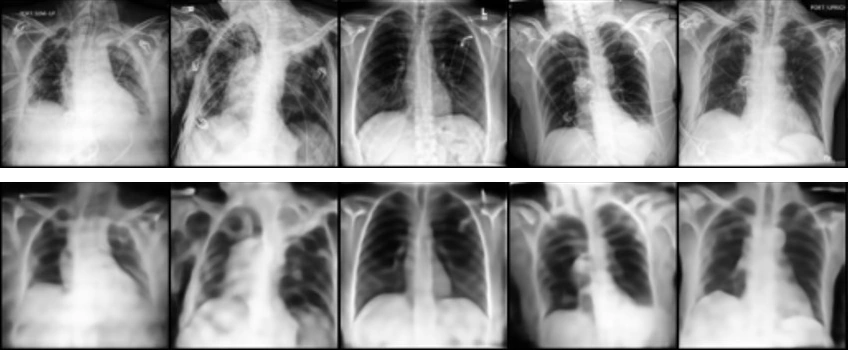<figcaption>The same model also reconstructs the anomalous group.</figcaption></figure>
</div>
```

This motivates a second question: **where does an observation lie relative to the training examples in latent space?** A nearest-neighbour detector can ask that question, but its usefulness now depends on the geometry learned by the encoder.

### Changing the geometry without reducing the dimension {#compression}

High-dimensional geometry creates a difficulty for a Gaussian latent prior. Typical samples from $\mathcal N(0,I_n)$ have radii close to $\sqrt n$, and almost every direction lies near the equator perpendicular to any fixed axis. Yet this narrow belt contains an enormous range of distinct directions: a finite training set can remain very sparse within it. Concentration near an equator does not mean concentration into a small, densely populated neighbourhood.

{fig-alt="A sphere with a shaded equatorial belt illustrating concentration of measure." width=80%}

My **hyperspherical-coordinate VAE** addresses this geometry directly. Its loss sets preferred means and spreads for the angular coordinates, alongside the radius. Moving the angular distributions away from their equatorial values reduces the volume occupied by the representation while keeping the same number of latent coordinates. Acting across the angular hierarchy gives more control than concentrating around a single direction.

**Volume compression can preserve variation across coordinates.** The histograms below show the angular distributions shifting while retaining finite widths. The reconstruction term helps preserve the distinctions the decoder needs; the aim is a compact region with useful internal structure.

{#fig-compression-angles fig-alt="Coordinate-wise angular histograms for three directional prescriptions, showing shifted distributions with nonzero spreads across the latent coordinates."}

<details class="ai-details">
<summary>Why the equator matters, and how the loss addresses it</summary>

**The geometric mechanism.** Hyperspherical angles describe direction through a sequence of nested subspheres. For each polar angle, the equatorial value is $\varphi_k=\pi/2$, or $\cos\varphi_k=0$. Under uniform spherical measure, angles associated with higher-dimensional subspheres concentrate especially strongly near these values.

For $z\in\mathbb R^n$, write its hyperspherical coordinates as $(r,\varphi_1,\ldots,\varphi_{n-1})$. The Euclidean volume element contains

$$
\mathrm dV=r^{n-1}\prod_{j=1}^{n-2}(\sin\varphi_j)^{n-j-1}\,\mathrm dr\,\mathrm d\varphi_1\cdots\mathrm d\varphi_{n-1}.
$$

The sine factors are largest at the equators. Moving a fixed-width angular region away from them makes these factors smaller; their large powers amplify the change in high dimension. This is why the method acts on angular location as well as spread, even when the radius is held fixed.

**A schematic loss.** Training balances reconstruction against angular and radial regularization:

$$
\mathcal L=\mathcal L_{\mathrm{rec}}
+\lambda\bigl(\mathcal R_{\mathrm{angular}}+\mathcal R_{\mathrm{radial}}\bigr).
$$

For an angular cosine $u_k=\cos\varphi_k$, a coordinate contributes

$$
\begin{aligned}
\mathcal R_k={}&\alpha_k\bigl(\langle u_k\rangle_b-a_k\bigr)^2\\
&+\gamma_k\bigl(s_b(u_k)-b_k\bigr)^2.
\end{aligned}
$$

Here $\langle\cdot\rangle_b$ and $s_b$ are the minibatch mean and standard deviation. The targets $a_k$ choose angular location, the targets $b_k$ choose spread, and the weights control each constraint. Choosing polar-cosine means away from zero drives the representation away from the equatorial regime. Nonzero spread targets and reconstruction allow observations to remain distinguishable.

These contributions are summed over angles for both the encoder's mean and standard-deviation vectors, with analogous penalties on their radii. Sampling uses Cartesian reparameterization. The loss therefore changes the learned geometry while retaining the latent coordinates used by the decoder.

This KL-inspired moment regularizer is developed in the [method paper](https://arxiv.org/abs/2507.15900), which gives the full objective and experimental settings.

</details>

### How to read the coarse representations {#coarse-representations}

**Each point represents one observation.** To obtain its coarse view, group the coordinates of its high-dimensional latent mean into three fixed blocks and average within each block. These three averages supply the plotted $x,y,z$ coordinates, followed by display rescaling. Apply the same grouping separately to every observation. This lets us see collective patterns across the coordinates while the model and its distance calculations retain the full latent dimension.

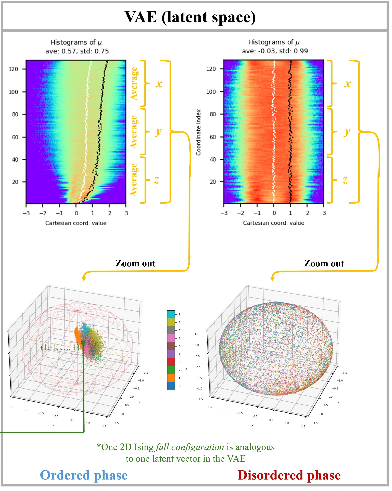{fig-alt="VAE panel from the phase paper, with yellow coordinate-grouping brackets and zoom-out arrows connecting the coordinate distributions to the coarse views."}

<details class="ai-details">
<summary>The Ising comparison, coordinates, and interpretation</summary>

**Why call this coarse-graining?** In the 2D Ising model, zooming out replaces a block of up/down spins by its majority orientation. Small fluctuations disappear, while sufficiently coherent domains remain visible. Repeating the operation distinguishes ordered configurations, disordered ones, and the patterns extending across many scales near the critical point.

{fig-alt="Ising panel from the phase paper: three temperature regimes before and after coarse-graining, with block-spin and zoom-out arrows."}

The latent-space analogy treats the coordinates as continuous spins: **one whole latent vector corresponds to one whole spin configuration**. Block averages play the role of local magnetizations. A directional bias shared by many coordinates can survive averaging; positive and negative fluctuations can cancel. This motivates the [latent-phase diagnostics](#latent-phases).

**The coordinate map.**

For the coordinate-averaged views, take the encoder's latent mean $\mu=(\mu_1,\ldots,\mu_d)$ and group its coordinates into three fixed blocks of roughly equal size, $B_1,B_2,B_3$. Each displayed axis starts from a block average:

$$
c_k(\mu)=\frac{1}{|B_k|}\sum_{j\in B_k}\mu_j,
\qquad k=1,2,3.
$$

Thus an illustrative vector $(3,1\mid 2,0\mid -1,1)$ becomes $(2,1,0)$ before display rescaling. We average **within each observation's vector**; different observations remain separate points. Colours identify classes, nominal and anomalous populations, or a property such as a tree's root probability, as specified in each caption.

**Read the normalization as well as the shape.** After averaging, a plot may rescale all points by one common factor, or normalize each point separately. A common factor preserves the relative radii of the coarse vectors. Per-point normalization keeps only their directions and places every point on a sphere; that shell is then part of the display prescription.

For example, the Logic VAE coarse views use $\sqrt{3}\,c/\|c\|$ without compression, and $\sqrt{3}\,c/\langle\|c\|\rangle$ with compression, where the latter denominator is the mean coarse-vector norm over the displayed observations. The apparent three-dimensional volumes are consequently not a measurement of high-dimensional compression. Reconstruction, interpolation, and anomaly scores are evaluated using the original latent vectors.

**What survives the summary?** Different vectors can have identical block averages, and the result depends on the coordinate basis and grouping. Coarse-graining does not preserve all distances or class structure, or by itself establish a phase transition. A diffuse coarse cloud can coexist with useful neighbourhoods in the full latent space, so coordinate distributions and task measurements provide complementary evidence.

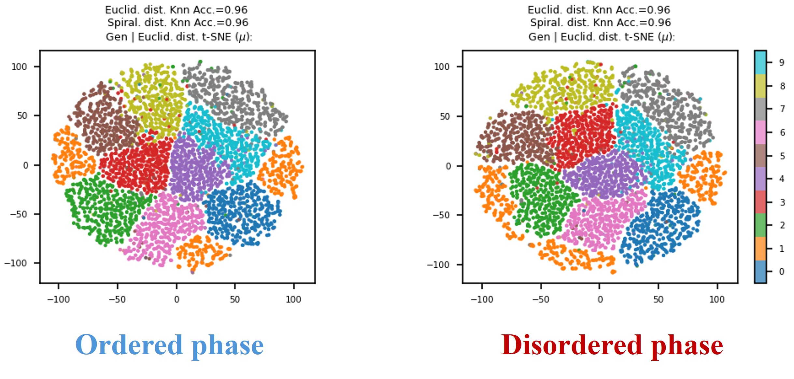{fig-alt="Class-coloured t-SNE plots with visible class structure for both the ordered and disordered latent representations."}

</details>

### Detecting anomalies in images {#image-anomalies}

**Training on nominal images alone.** Galaxy Zoo and Mars Rover Mastcam provide two applications without normal-subclass labels in representation training. After training, the nominal latent means form a reference set. A test image is scored by its distance to nearby reference examples. Compression changes that reference geometry; the scoring principle remains the same.

```{=html}
<figure class="ai-gallery">
<h4>Galaxy Zoo · unconditional anomaly detection</h4>
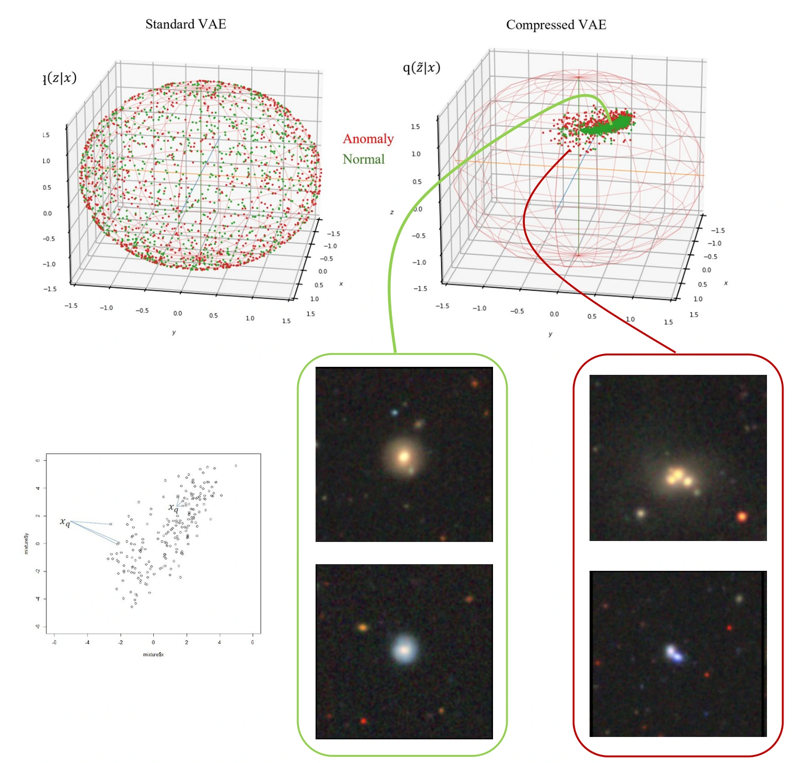
<figcaption>Galaxy Zoo: standard and compressed latent representations. The standard VAE is on the left and the compressed VAE on the right. Green marks nominal galaxies; red marks anomalies. Arrows connect the compressed representation to explicit examples from each population. The inset illustrates the nearest-neighbour distance used for anomaly scoring.</figcaption>
</figure>
```

{fig-alt="Nominal and anomalous Galaxy Zoo score distributions before and after compression."}

| Dataset | Standard VAE + kNN AUROC | Compressed VAE + kNN AUROC |
|:--|--:|--:|
| Mars Rover Mastcam | 0.664 | **0.764** |
| Galaxy Zoo | 0.741 | **0.789** |

These are the thesis's matched VAE comparisons. The improvement in overall ranking does not imply improvement at every operating point: Galaxy Zoo FPR95 changes from 0.77 to 0.80, whereas Mastcam changes from 0.66 to 0.62. The [AD paper](https://arxiv.org/abs/2601.18823) reports the other detectors and metrics.

**When the normal classes are known.** A separate set of experiments uses ID class labels to organize different class clusters. Here the difficult cases are nearby alternatives: tench versus goldfish, or an English versus a Welsh springer spaniel. The experiments include CIFAR-10 versus CIFAR-100 and Imagenette versus semantically close ImageNet classes.

```{=html}
<details class="ai-details">
<summary>Evolution of the latent representations during training</summary>
<div class="ai-motion" data-paired-video>
<div class="ai-pair">
<figure><h4>Single-direction concentration · vMF</h4><video controls loop muted playsinline preload="metadata" poster="../assets/ai/visuals/latent-vmf-poster.webp" aria-label="Training evolution of nominal Imagenette representations for the von Mises–Fisher comparison"><source src="../assets/ai/visuals/latent-vmf.mp4" type="video/mp4"></video></figure>
<figure><h4>Hyperspherical compression</h4><video controls loop muted playsinline preload="metadata" poster="../assets/ai/visuals/latent-compressed-poster.webp" aria-label="Training evolution of nominal Imagenette representations for the compressed VAE"><source src="../assets/ai/visuals/latent-compressed.mp4" type="video/mp4"></video></figure>
</div>
<div class="ai-media-controls" hidden><button type="button" class="ai-button" data-play-pair>Play both training animations</button><button type="button" class="ai-button" data-reset-pair>Restart animations</button></div>
<p class="ai-caption">Evolution of the latent representations during training. Both show <a href="#coarse-representations">coordinate-averaged views</a> of high-dimensional Imagenette representations, with colours distinguishing the nominal ID classes. Only nominal samples are displayed here. The vMF comparison concentrates one direction; the proposed prescription controls the full angular hierarchy. Press play to follow how the representations develop during training.</p>
</div>
</details>
```

```{=html}
<figure class="ai-gallery">
<h4>Imagenette · conditional near-OOD detection</h4>
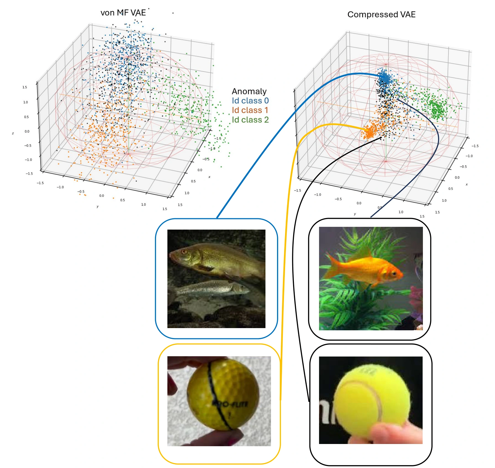
<figcaption>Conditional comparison. Left: von Mises–Fisher VAE; right: hyperspherical compression. Colours distinguish nominal classes, while black points mark anomalies from semantically close ImageNet classes. The examples show nominal tench and golf balls alongside anomalous goldfish and tennis balls, with arrows linking them to the coarse-grained representation.</figcaption>
</figure>
```

### What changes for generation? {#generation}

Reconstructing an encoded image and decoding a newly sampled latent vector are different tests. A decoder can work well near the encoded observations while behaving poorly in other regions visited by its sampling distribution. This is especially visible when we give a relatively simple VAE a large latent space.

{fig-alt="MNIST originals, reconstructions and generated digits compared between standard and compressed VAEs."}

The thesis studies both generation and the routes between encoded examples. The sequences below decode intermediate latent locations for three digit pairs. They make it possible to inspect the continuity and recognizability of the outputs, rather than judging a representation only by reconstruction error.

```{=html}
<div class="ai-interpolation" data-interpolation>
<div class="ai-pair">
<figure><h4>Standard VAE</h4>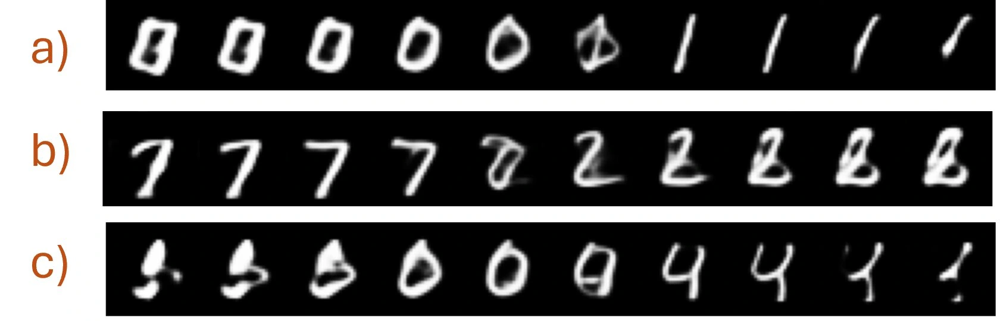</figure>
<figure><h4>Compressed VAE</h4></figure>
</div>
<details class="ai-details ai-scrubber" hidden>
<summary>Explore the interpolation</summary>
<div class="ai-frame-pair">
<figure><figcaption>Standard VAE</figcaption></figure>
<div class="ai-path-labels" aria-hidden="true"><span>0 → 1</span><span>7 → 2</span><span>3 → 4</span></div>
<figure>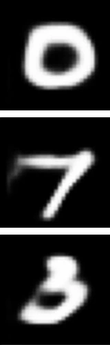<figcaption>Compressed VAE</figcaption></figure>
</div>
<label for="interpolation-step">Saved step <output id="interpolation-position" for="interpolation-step">1 of 10</output></label>
<input id="interpolation-step" type="range" min="0" max="9" value="0" step="1" aria-describedby="interpolation-note">
<p class="ai-caption" id="interpolation-note">Three paths: 0 → 1, 7 → 2, and 3 → 4. Move the slider to compare the ten interpolation steps.</p>
</details>
</div>
```

The comparison does not mean that the standard VAE had no class structure. In this MNIST experiment, kNN classification in the full latent space was already strong in both models, and was higher without compression (0.95 versus 0.88). Geometry that helps sampling or a particular anomaly score need not maximize every other task.

<details class="ai-details">
<summary>Reconstruction, generation, and the sampling distribution</summary>

The MNIST compressed model samples from an **effective prior** fitted to the embedding's empirical mean and covariance; the reported experiment estimated those statistics from the embedded test set. Its generated samples therefore illustrate the combined compression-and-sampling prescription, rather than unchanged standard-Gaussian sampling.

For CIFAR-10 and CelebA, the thesis examines the trade-off across latent sizes and regularization strengths. Reconstruction is measured by MSE. **Self-FID** compares generated images with reconstructed test images, so it measures agreement with the decoder's reconstructed distribution rather than conventional FID against the original images.

{fig-alt="CIFAR-10 MSE versus self-FID curves with example reconstructed and generated images."}

</details>

[Read the generation paper →](https://arxiv.org/abs/2507.15900){.card-link}

### How much compression is useful? {#latent-phases}

Compression is not a prescription to make every observation identical. Too little organization leaves a diffuse representation; too much can erase distinctions needed by the decoder or detector. In the experiments, useful behaviour appears in an intermediate, partially ordered regime.

{fig-alt="Galaxy Zoo detection and latent geometry compared across overcompressed, intermediate and undercompressed regimes."}

The spin-glass work develops a way to study this organization through **observables of the latent representations**. Fix a decoder and an observation: reconstruction and regularization define an energy over candidate latent configurations. Directions assigned to different observations can be compared through their overlaps, while [coordinate coarse-graining](#coarse-representations) tests which structures remain visible as detail is removed.

The [angular histograms above](#fig-compression-angles) complement these coarse views: they show how each coordinate's distribution responds to the preferred direction, revealing the hierarchy of angular organization.

The phase diagnostics ask more than whether a cloud looks clustered. Both standard and compressed models can contain class information, but differ in the stability of that organization under coarse-graining and in its usefulness for generation or distance-based detection. The interpretation concerns finite trained systems, with the diagnostics checked against their task performance.

[Read the latent-phase study →](https://arxiv.org/abs/2606.02600){.card-link}

### When the benchmark changes the answer {#benchmark-geometry}

A common AD test declares one class anomalous and trains on all the others. This creates a semantic distinction, but it does not guarantee that the held-out class will be far from the normal mixture. If it lies in the mixture's interior, an ordinary distance-based score can rank its examples as *less* unusual than the designated normal examples.

```{=html}
<div class="ai-pair">
<figure><h4>FashionMNIST</h4></figure>
<figure><h4>CIFAR-10</h4></figure>
</div>
```

These projections illustrate contrasting degrees of class overlap; the study evaluates the effect using scores in the underlying representations. A detector with a fixed score direction can move from a useful ranking to chance or inversion as the held-out class changes. This makes the geometry of the evaluation protocol part of the scientific question.

<details class="ai-details">
<summary>See the per-class score reversals</summary>

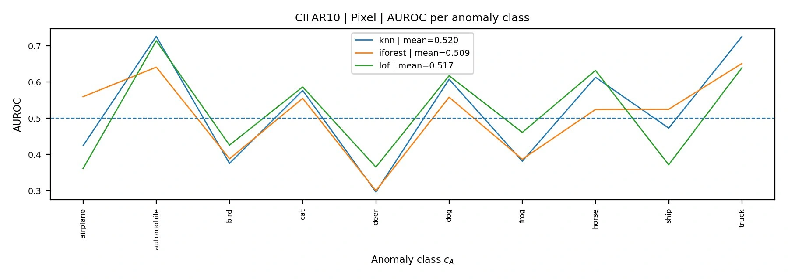{fig-alt="Per-class CIFAR-10 AUROC curves crossing the chance line for different anomaly detectors."}

</details>

[Read “Testing the Test” →](https://arxiv.org/abs/2606.02601){.card-link}

### From images to molecules {#molecular-anomalies}

Can the same approach expose structure associated with a much different kind of property? In an extension beyond the thesis's image experiments, I apply hyperspherical compression to an NP-VAE molecular model trained on **random ZINC molecules**, without docking scores, docking poses, or protein-target information in its training objective.

The evaluation uses molecules selected from the favourable and unfavourable extremes of an NSP14 docking-score collection. Each group is compared separately with held-out random ZINC. The question is whether an unsupervised molecular geometry makes membership in those externally selected populations accessible through a simple latent-distance score.

```{=html}
<figure class="ai-gallery ai-molecule-examples">
<h4>Nominal · random ZINC</h4>

<h4>Best docking</h4>
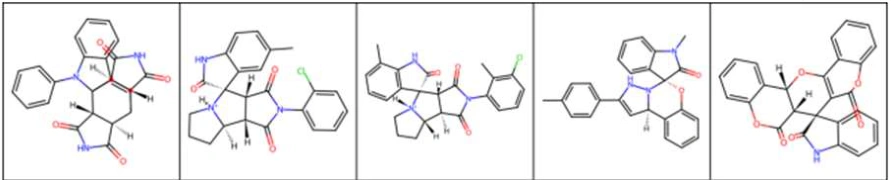
<h4>Worst docking</h4>
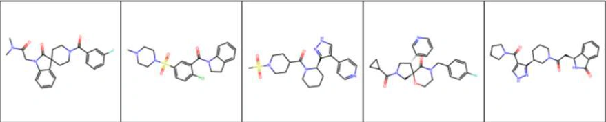
<figcaption>Examples from the nominal, best-docking, and worst-docking populations.</figcaption>
</figure>
```

The following three views show the **same nominal ZINC island in red**. The grey population changes from the low-docking subset, closer to that island, to the high-docking subset, farther away. In this experiment, the better-docking molecules are more specialized relative to random ZINC, and that distinction is visible in a representation learned without docking supervision. “High docking” here means better docking ability, rather than a numerically higher raw docking score.

```{=html}
<div class="ai-motion" data-paired-video data-playback-rate="2" data-play-label="Play all three comparisons" data-pause-label="Pause all three comparisons">
<div class="ai-triptych">
<figure><h4>View a</h4><video controls loop muted playsinline preload="metadata" poster="../assets/ai/visuals/molecular-view-a-low.webp" aria-label="View a: low- and high-docking molecular populations alternate around a fixed nominal ZINC reference"><source src="../assets/ai/visuals/molecular-view-a.mp4" type="video/mp4"><a href="../assets/ai/visuals/molecular-view-a.mp4">Download view a.</a></video><figcaption>Inspect stills: <a href="../assets/ai/visuals/molecular-view-a-low.webp">low docking</a> · <a href="../assets/ai/visuals/molecular-view-a-high.webp">high docking</a>.</figcaption></figure>
<figure><h4>View b</h4><video controls loop muted playsinline preload="metadata" poster="../assets/ai/visuals/molecular-view-b-low.webp" aria-label="View b: low- and high-docking molecular populations alternate around a fixed nominal ZINC reference"><source src="../assets/ai/visuals/molecular-view-b.mp4" type="video/mp4"><a href="../assets/ai/visuals/molecular-view-b.mp4">Download view b.</a></video><figcaption>Inspect stills: <a href="../assets/ai/visuals/molecular-view-b-low.webp">low docking</a> · <a href="../assets/ai/visuals/molecular-view-b-high.webp">high docking</a>.</figcaption></figure>
<figure><h4>View c</h4><video controls loop muted playsinline preload="metadata" poster="../assets/ai/visuals/molecular-view-c-low.webp" aria-label="View c: low- and high-docking molecular populations alternate around a fixed nominal ZINC reference"><source src="../assets/ai/visuals/molecular-view-c.mp4" type="video/mp4"><a href="../assets/ai/visuals/molecular-view-c.mp4">Download view c.</a></video><figcaption>Inspect stills: <a href="../assets/ai/visuals/molecular-view-c-low.webp">low docking</a> · <a href="../assets/ai/visuals/molecular-view-c-high.webp">high docking</a>.</figcaption></figure>
</div>
<div class="ai-media-controls" hidden><button type="button" class="ai-button" data-play-pair>Play all three comparisons</button><button type="button" class="ai-button" data-reset-pair>Return to low docking</button></div>
<p class="ai-caption">Three perspectives of the compressed molecular representation. Each alternates the observed low- and high-docking populations every 1.5 seconds, keeping its axes, viewpoint, and nominal reference in place. Red: nominal ZINC. Grey: docking-selected molecules. These <a href="#coarse-representations">coarse-grained views</a> illustrate the geometry; anomaly scores use distances in the full 256-dimensional latent space.</p>
</div>
```

In a representative matched comparison, compressed latent kNN reaches AUROC **0.892** for the favourable-docking subset and **0.787** for the unfavourable subset, compared with **0.780** and **0.653** for Morgan-fingerprint/Tanimoto kNN. The corresponding uncompressed-VAE scores are **0.722** and **0.635**. These are individual matched results, rather than averages over runs.

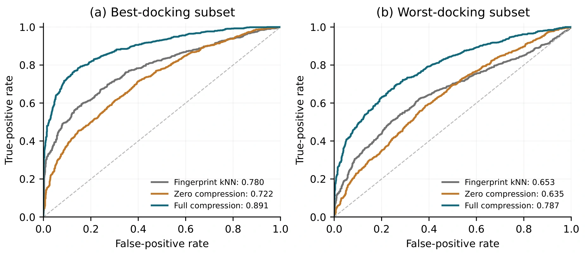{fig-alt="ROC curves comparing fingerprints and standard and compressed molecular latent representations for favourable and unfavourable docking subsets."}

The result concerns **docking-related population structure accessible without docking supervision**. Docking is a three-dimensional, target-dependent scoring task, yet molecular differences associated with its selected extremes become accessible through a representation trained on molecular structure alone. Compression improves that accessibility beyond the tested fingerprint baseline. The low-to-high comparisons above make the observed direction concrete: the better-docking population lies farther from the random-ZINC reference island.

There is a second connection to the image experiments: continued training can improve molecular reconstruction while removing the AD advantage. Preserving information for decoding and arranging it for a useful distance score are related but different objectives. This molecular work is ongoing; its representative results currently concern one docking collection and target.

## 2. Learning to recognise logical violations {#logical-anomalies}

The geometric approach asks where an observation lies relative to a reference population. A different kind of question begins with an explicit expectation: **which relation should hold, and does this observation support it?** An ordinary-looking scene can violate that expectation, while a visually unusual scene may satisfy it.

Watch the two short videos below. In both, a cube collides with a blue object during the first half of the clip. Yet only one satisfies the rule we are testing: **a cube–blue-object collision must be preceded by an entry event, and an entry followed by a collision must lead to a collision in the first half.** In the first video, the colliding objects are already present at the start. In the second, the yellow cube enters the scene and then collides with the blue sphere. The difference lies in the sequence of events, even though both scenes look ordinary.

Let $A$ denote a cube–blue-object collision, $B$ an entry followed by a collision for that pair, and $C$ a collision of that pair in the first half. The rule is

$$
(A\Rightarrow B)\wedge(B\Rightarrow C).
$$

Here “cube” and “blue” select the two participants; they do not require the cube itself to be blue. The truth values below follow the annotations used in the experiment.

```{=html}
<div class="clevr-video-pair" style="display: grid; grid-template-columns: repeat(auto-fit, minmax(min(100%, 280px), 1fr)); gap: 1.25rem; margin: 1.5rem 0;">
<figure style="margin: 0;">
<video controls loop muted playsinline preload="metadata" width="480" height="320" poster="../assets/ai/clevrer/chain-violation.jpg" aria-label="CLEVRER chain-rule violation: a cube and a blue object collide without a preceding entry event" style="display: block; width: 100%; height: auto;">
<source src="../assets/ai/clevrer/chain-violation.mp4" type="video/mp4">
<a href="../assets/ai/clevrer/chain-violation.mp4">Download the rule-violation video.</a>
</video>
<figcaption><strong>Rule violated.</strong> The blue cube and blue cylinder are present from the start and collide in the first half. The entry-then-collision event is absent, so the first implication fails. Ground truth: A = true, B = false, C = true.</figcaption>
</figure>
<figure style="margin: 0;">
<video controls loop muted playsinline preload="metadata" width="480" height="320" poster="../assets/ai/clevrer/chain-satisfaction.jpg" aria-label="CLEVRER chain-rule satisfaction: a yellow cube enters and collides with a blue sphere in the first half" style="display: block; width: 100%; height: auto;">
<source src="../assets/ai/clevrer/chain-satisfaction.mp4" type="video/mp4">
<a href="../assets/ai/clevrer/chain-satisfaction.mp4">Download the rule-satisfaction video.</a>
</video>
<figcaption><strong>Rule satisfied.</strong> The yellow cube enters and collides with the blue sphere in the first half. Both implications hold. Ground truth: A = true, B = true, C = true.</figcaption>
</figure>
</div>
```

*CLEVRER examples from my logical anomaly-detection experiments. Press play to watch each clip; playback loops until paused. Each full clip lasts about five seconds.*

### How does a scene give evidence for a rule? {#rule-evaluation}

Return to the two videos. The first implication, $A\Rightarrow B$, is false precisely when the collision occurs but the entry-then-collision event is absent. The second, $B\Rightarrow C$, tests whether an entry-then-collision event is accompanied by a collision in the first half. Their conjunction requires both implications to hold. The first clip is therefore an anomaly **relative to that rule**. A reader who disagrees with the expectation can inspect it, replace it, and ask a different question of the same video.

A third clip illustrates a different compound rule. For a sphere–cylinder pair, require that a collision implies **both** a collision in the first half **and** an entry followed by a collision:

$$
A_{\rm sc}\Rightarrow(C_{\rm sc}\wedge B_{\rm sc}).
$$

```{=html}
<figure style="max-width: 480px; margin: 1.5rem auto;">
<video controls loop muted playsinline preload="metadata" width="480" height="320" poster="../assets/ai/clevrer/compound-violation.jpg" aria-label="CLEVRER compound-rule violation: a sphere and cylinder collide after the halfway point" style="display: block; width: 100%; height: auto;">
<source src="../assets/ai/clevrer/compound-violation.mp4" type="video/mp4">
<a href="../assets/ai/clevrer/compound-violation.mp4">Download the compound-rule video.</a>
</video>
<figcaption><strong>Compound rule violated.</strong> The sphere–cylinder collision and the entry-then-collision event are present, but the first-half collision condition is false. One failed conjunct is enough to violate the rule. Ground truth: A<sub>sc</sub> = true, B<sub>sc</sub> = true, C<sub>sc</sub> = false.</figcaption>
</figure>
```

Even perfect knowledge of the marginal probabilities would leave something unresolved. For the first implication of the cube–blue-object rule, the violation probability is $P(A\wedge\neg B)$, which depends on how the events are related. Here an entry followed by a collision is itself evidence for a collision. Multiplying scalar probabilities under an independence assumption discards that relationship. A learned evaluator can carry perceptual evidence for both operands into the decision.

I specify the expression as a tree, or a graph when subexpressions are shared. A perceptual encoder supplies visual features and the leaf bank estimates the concepts. In the current trainer the same encoder feature vector is available at each leaf. For every internal node, a small network learns its particular subexpression from its children's features and the negations on the incoming edges. It returns a local truth estimate and a new feature vector. The vector travels upward. The estimate lets us inspect the clause in its own right.

During training, annotated concept values determine an exact Boolean target at each node. Lower subtrees are trained first and frozen when their parent is learned. A matching subtree can therefore be used again. A new parent generally needs its own training, even when both children are familiar. At inference, a new video passes through the assembled graph and we can follow the estimates from the leaves to the root.

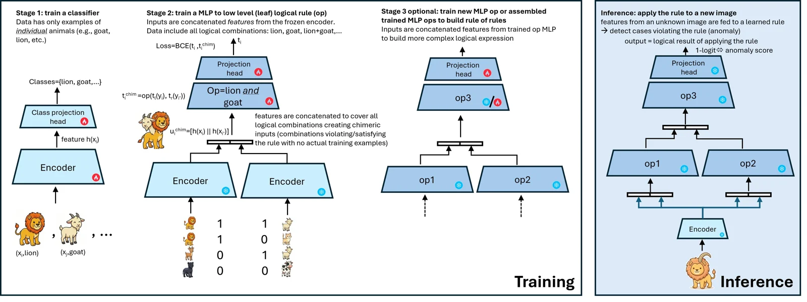{fig-alt="Diagram of perceptual training, local gate training, reuse within a larger expression, and inference."}

### How can it learn a violation it has never seen? {#chimera-training}

Suppose every training clip with a cube–blue-object collision also has the corresponding entry-then-collision event. The implication is always satisfied. A classifier that always answers “true” fits those examples perfectly. Yet the collection may contain plenty of evidence for each side of the missing combination: clips in which a collision occurs, and other clips in which the entry-then-collision event is absent.

**Chimera training** uses that distinction. Take the left operand's feature from a clip with $A=1$, and the right operand's feature from another with $B=0$. Keep the truth label that belongs to each operand. The training target for this pair is now exactly $1\Rightarrow 0=0$. The construction also works higher in the graph, where an operand can be the learned feature of an entire clause. It creates a labelled pair of features; it makes no claim that the pair depicts a physically realizable clip. It needs each required operand value to occur somewhere. At test time, both operands come from the same observation again.

A small image experiment makes the effect visible. Train a conjunction on the concepts “one” and “seven,” then ask which real handwritten sevens score highest. Some sevens carry visual evidence for both digits even though each has a single annotated class.

{fig-alt="A row of handwritten sevens ordered from low to high learned evidence for the conjunction of one and seven."}

<details class="ai-details" id="independent-correlated">
<summary>Why train an evaluator instead of composing probabilities?</summary>

If the relevant events are independent, their individual truth probabilities contain everything needed to compose them. For example, writing $p_A=P(A)$ and $p_B=P(B)$ gives

$$
P(A\wedge B)=p_Ap_B,\qquad
P(A\Rightarrow B)=1-p_A(1-p_B).
$$

In that regime, a trained gate need not improve on the appropriate algebraic formula. The tested static **CLEVR** rules illustrate this: independent probability composition was already near perfect. Learning a neural evaluator is useful when there is additional joint information to recover, rather than simply to reproduce an available formula.

**CLEVRER** makes the distinction sharper. Events share objects and are linked through time: an entry followed by a collision entails a collision, and related clauses can describe different aspects of the same interaction. In general, the exact probability of an implication is

$$
P(A\Rightarrow B)=1-P(A\wedge\neg B)
                 =1-P(A)+P(A\wedge B).
$$

The joint term $P(A\wedge B)$ cannot be recovered from the two marginals alone without an assumption about dependence. For example, $p_A=p_B=1/2$ gives an implication probability of $3/4$ under independence, but $1$ if the events always coincide. The individual probabilities are identical; their relationship changes the answer.

This is why the evaluator passes **features as well as truth estimates** up the expression. Those features retain evidence about the shared scene that a single scalar per operand can discard. Local Boolean supervision and chimera training teach each node how to use that evidence, while the meaning of conjunction and implication remains unchanged. In the event-rich CLEVRER experiments, mean anomaly AUROC rose from **0.750** with independent composition to **0.833** with the learned evaluator. The contrast with CLEVR identifies the intended advantage: handling relations for which independent composition leaves out useful information.

</details>

## 3. Generating reasoning structures {#generative-reasoning}

The evaluator asks whether an observation supports a supplied rule. The next step is to make reasoning structures themselves objects of generative modelling. This part brings the compression VAE and logical evaluation together, then develops witnessed relations, world models, and ontology search. The generative work is ongoing; the planning and ontology-search sections describe the broader research programme.

### Generating rules and their truth profiles {#logic-vae}

The **Logic VAE** learns a generative representation of labelled reasoning trees, conditioned on the probabilities of their leaves. Its input separates two kinds of information: the tree specifies the topology, logical operators, and concept identifiers; the condition specifies how probable those concepts are in a particular observation.

The encoder maps the labelled tree and its leaf-probability condition to a latent representation. A conditional decoder reconstructs or generates the labelled tree. A **separate predictor network uses the latent representation to infer probabilities for the non-leaf nodes**, including the root. These internal-node probabilities are prediction targets during training; they are not supplied to the encoder.

This makes the observation part of the datapoint. The same syntactic tree, with exactly the same concept identifiers, can be evaluated for two different video clips. If the clips give different leaf-probability conditions, the resulting inputs will generally map to different latent points. Conversely, fixing a clip lets us explore different reasoning structures under its concept-probability condition.

{fig-alt="A labelled tree enters a conditional encoder and latent space. The latent representation branches to a conditional decoder producing a tree and a separate predictor producing internal-node probabilities. Leaf probabilities condition the encoder and decoder; internal-node targets do not enter the encoder."}

Sampling, interpolation, and search choose latent codes from which the model can generate reasoning structures and predict their truth profiles. The compression method introduced earlier now organizes this space of reasoning structures. The present synthetic experiment focuses on **interpolation**: as the code and condition vary, how accurately does the predictor estimate the probabilities of the resulting tree?

#### A synthetic test of the workflow {#logic-vae-experiment}

To test this workflow in a controlled setting, I construct synthetic witnessed trees built from alternative implication paths and explicit witness atoms, using the [homotopical construction below](#witnessed-relations), and compute their nodewise probability profiles using **independent-event composition formulas**. Repeated occurrences are treated as independent copies with the same marginal probability. This gives readily generated reference values throughout the tree, against which the model's predictions can be checked.

<details class="ai-details">
<summary>The synthetic probability ground truth</summary>

If the two child probabilities are $a$ and $b$, the recursive prescription is

$$
\begin{aligned}
p(A\wedge B)&=ab, & p(A\vee B)&=a+b-ab,\\
p(A\Rightarrow B)&=1-a+ab, & p(A\Leftrightarrow B)&=ab+(1-a)(1-b).
\end{aligned}
$$

Negation maps $a$ to $1-a$. The calculation proceeds from the leaves to the root, retaining every intermediate value. A repeated label denotes independent occurrences sharing a marginal: for example, two occurrences of a concept with probability $a$ give $a^2$ under conjunction. This is the benchmark's independent-copy semantics; identifying both occurrences as the same event would instead give $a$.

</details>

The experiment uses 64 concepts and a 512-dimensional latent space. Each input is a labelled witnessed tree together with a 64-component leaf-probability condition. The analytical internal-node values supervise the predictor. Generated leaves receive the probabilities associated with their decoded concept identifiers. Interpolation starts from validation examples held out of gradient training. A reconstruction gives the first view of what the model has learned:

{fig-alt="Detailed original and reconstructed witnessed trees with probabilities at the leaves and internal nodes."}

Tree reconstruction asks whether the original labels and branching structure survive encoding and decoding. Truth-profile prediction asks whether the inferred internal-node probabilities agree with the analytical evaluation. The figure displays both tests; node probabilities are rounded to one decimal place.

<details class="ai-details">
<summary>Compare reconstructions and browse more examples</summary>

```{=html}
<div class="ai-pair">
<figure><h4>Without compression</h4>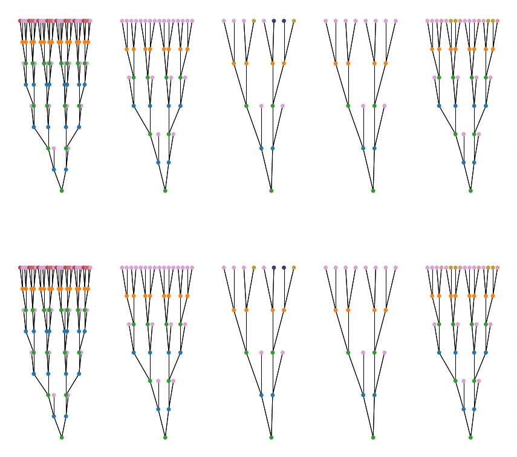<figcaption>Originals above; reconstructions below. Colours distinguish the node labels.</figcaption></figure>
<figure><h4>With compression</h4>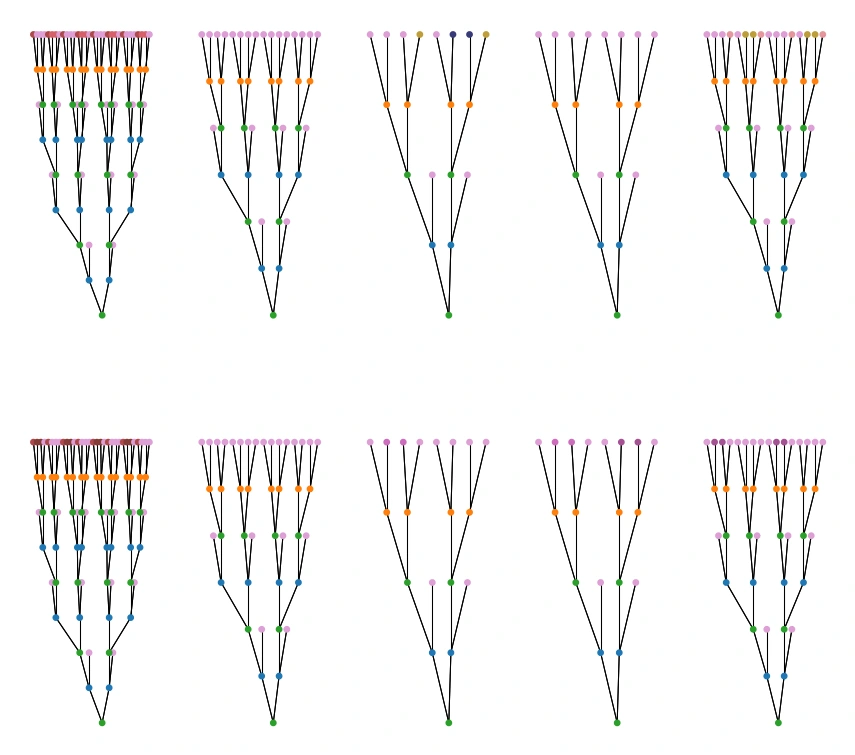<figcaption>Originals above; reconstructions below, with the same colour code.</figcaption></figure>
</div>
```

Colours identify the concept labels at the leaves and the operators at internal nodes; they do not encode truth probabilities. **Both models reconstruct the graph topology very well in these examples, while compression is somewhat worse at reconstructing the concept labels.** Random sampling was disabled in the compressed experiment because of this reconstruction limitation.

</details>

#### Moving between reasoning structures {#logic-vae-interpolation}

Choose two encoded examples and move between them. At each of 20 steps, decode a tree and predict its internal probabilities. Then apply the independent-event formulas to that generated tree to obtain a reference profile. **Does the predicted profile remain consistent as the generated structure changes?**

Both the latent code and the conditioning leaf-probability vector vary along these paths. The interpolation procedure linearly blends the two endpoint vectors in each space, then rescales each blend to the respective mean norm over validation examples. These are therefore jointly varying code-and-condition paths. The numerical path is continuous; the decoded tree changes discretely. Use the slider to inspect the intermediate structures, or play the sequence.

**The quantity tested along each interpolation is the error in predicted node probabilities.** The compressed and uncompressed animations have different starting and ending trees because representative interpolations were selected separately for inspection in the two experiments. The error curve advances with the corresponding tree animation, showing the prediction error up to the current step.

These selected examples illustrate the behaviour of each model; they are not a random or statistically representative sample of all possible paths, or a comparison of the same endpoint pair.

```{=html}
<div class="ai-logic-viewer" data-logic-viewer data-asset-root="../assets/ai/logic-vae/">
<div class="ai-logic-controls" hidden>
<div class="ai-logic-toolbar">
<label for="logic-model">Model <select id="logic-model" aria-label="Model"><option value="full">With compression</option><option value="zero">Without compression</option></select></label>
<button type="button" class="ai-button" data-logic-play>Play interpolation</button>
<button type="button" class="ai-button" data-logic-reset>Reset</button>
</div>
<label class="ai-logic-step-label" for="logic-step">Interpolation step <output id="logic-step-label" for="logic-step">1 of 20 · t = 0.00</output></label>
<input id="logic-step" type="range" min="0" max="19" step="1" value="0" aria-describedby="logic-reading-guide">
</div>
<div class="ai-logic-tree-labels"><strong data-logic-reference>Original endpoint tree · reference profile</strong><strong>Decoded tree · predicted profile</strong></div>
<figure class="ai-logic-tree">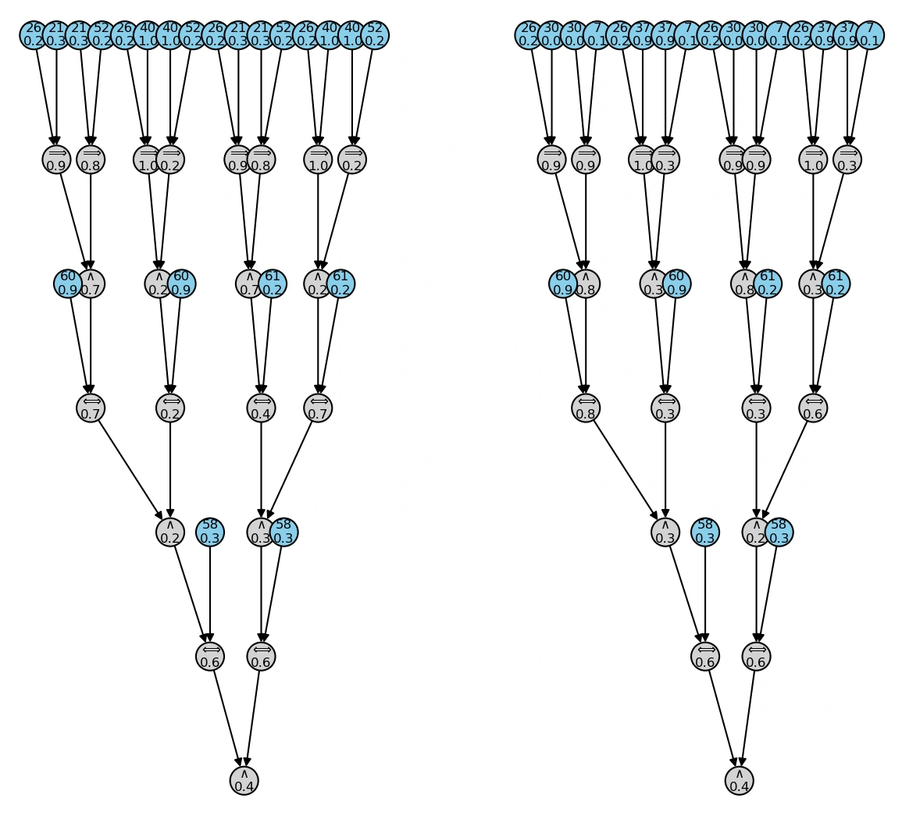<figcaption id="logic-reading-guide"><span data-logic-frame-caption>The original endpoint tree and reference profile are on the left; reconstruction and predictions are on the right.</span> Click the figure to enlarge it.</figcaption></figure>
<figure class="ai-logic-error">
<svg class="ai-logic-error-plot" data-logic-error viewBox="0 0 1050 375" role="img" aria-labelledby="logic-error-title logic-error-description">
<title id="logic-error-title">Node-probability error along the interpolation</title>
<desc id="logic-error-description">The curve is revealed up to the current interpolation step, in sync with the decoded tree.</desc>
<defs><clipPath id="logic-error-legend"><rect x="495" y="37" width="118" height="24"/></clipPath></defs>
<image data-logic-error-image href="../assets/ai/logic-vae/full-error-curve.webp" width="1050" height="375"/>
<rect data-logic-error-mask x="113" y="35" width="925" height="290" fill="white"/>
<line data-logic-error-cursor x1="112" x2="112" y1="35" y2="325" stroke="#285a61" stroke-width="1.5" stroke-dasharray="5 4"/>
<image data-logic-error-image href="../assets/ai/logic-vae/full-error-curve.webp" width="1050" height="375" clip-path="url(#logic-error-legend)"/>
</svg>
<figcaption>Probability error along the selected path, revealed with the tree animation. At each step, the predictor is compared with the analytical probabilities of that decoded tree, across all internal nodes including the root. The vertical marker indicates the current interpolation step, k = <span data-logic-error-step>0</span>.</figcaption>
</figure>
<p class="ai-caption" data-logic-run>Compressed model · selected epoch 520 · representative path 665–2649.</p>
<details class="ai-details">
<summary>Follow the path through the latent space</summary>
<div class="ai-pair">
<figure><h4>t-SNE view</h4>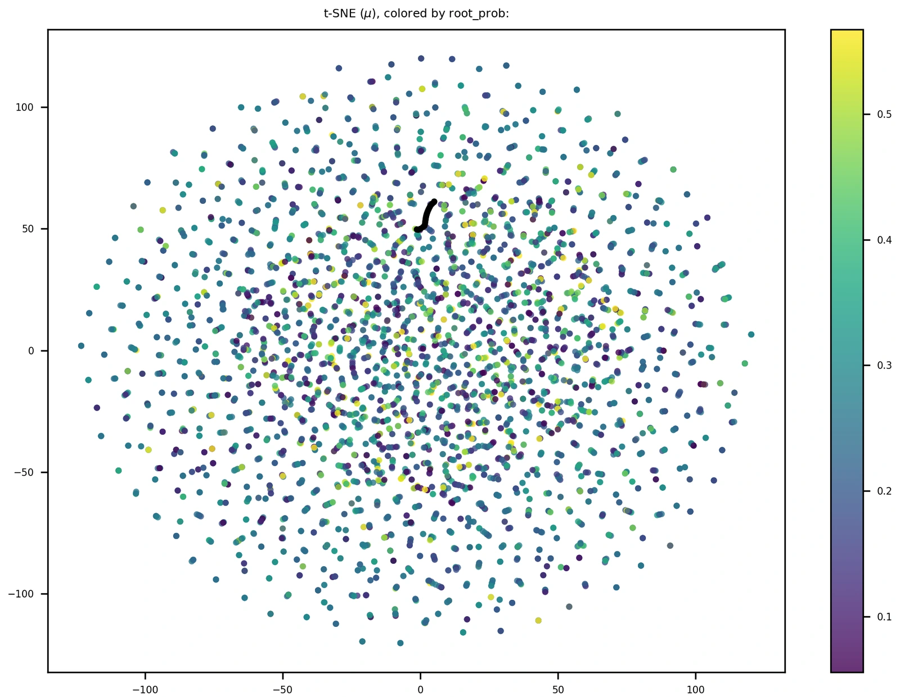<figcaption>Background colours indicate reference root probabilities. Black dots mark the interpolation path.</figcaption></figure>
<figure><h4>Coarse coordinate view</h4>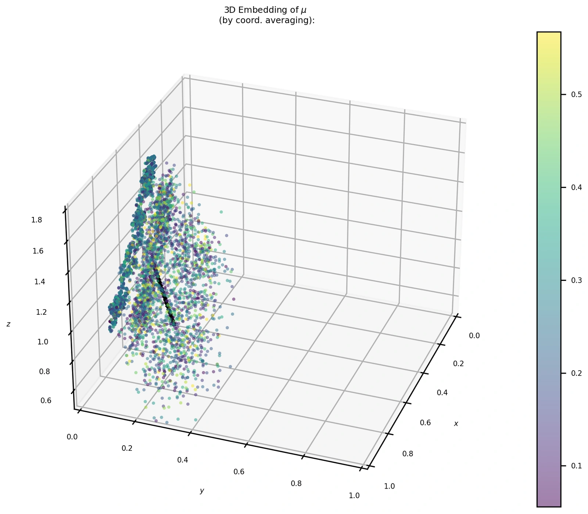<figcaption><a href="#coarse-representations">Coordinate averages</a> give a second view of the same path through the high-dimensional representation.</figcaption></figure>
</div>
</details>
<noscript><p>The first compressed-model frame is shown above. Enable JavaScript to animate the trees and error curve together or switch between models.</p><style>.ai-logic-error { display: none; }</style>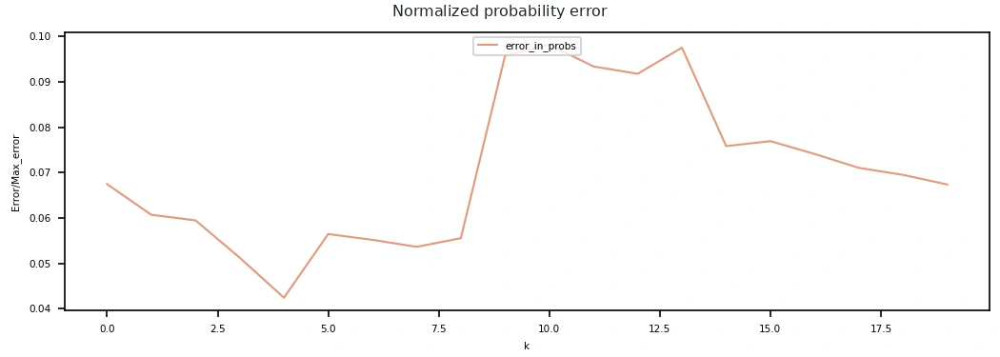</noscript>
</div>
```

#### Geometry, interpolation, and the reconstruction trade-off {#logic-vae-results}

The geometric question carries over from images and molecules: can we organize the latent representation so that moving through it remains useful? The training animations and loss plots can be explored below.

```{=html}
<details class="ai-details">
<summary>Training evolution and losses</summary>
<p>These animations show the evolution during training. Colours indicate reference root probabilities. The high-dimensional space is shown through <a href="#coarse-representations">coarse coordinate averages</a>.</p>
<div class="ai-motion" data-paired-video>
<div class="ai-pair">
<figure><h4>Without compression</h4><video controls muted playsinline preload="none" width="960" height="882" poster="../assets/ai/logic-vae/zero-training-poster.webp" aria-label="Training evolution of the Logic VAE without compression, epochs 10 to 540"><source src="../assets/ai/logic-vae/zero-training.mp4" type="video/mp4"><a href="../assets/ai/logic-vae/zero-training.mp4">Download training animation.</a></video><figcaption>Epochs 10–540. Poster: selected epoch 200.</figcaption></figure>
<figure><h4>With compression</h4><video controls muted playsinline preload="none" width="960" height="882" poster="../assets/ai/logic-vae/full-training-poster.webp" aria-label="Training evolution of the Logic VAE with compression, epochs 10 to 520"><source src="../assets/ai/logic-vae/full-training.mp4" type="video/mp4"><a href="../assets/ai/logic-vae/full-training.mp4">Download training animation.</a></video><figcaption>Epochs 10–520. Poster: selected epoch 520.</figcaption></figure>
</div>
<div class="ai-media-controls" hidden><button class="ai-button" type="button" data-play-pair>Play both training animations</button><button class="ai-button" type="button" data-reset-pair>Reset both</button></div>
</div>
<figure><h4>Without compression</h4>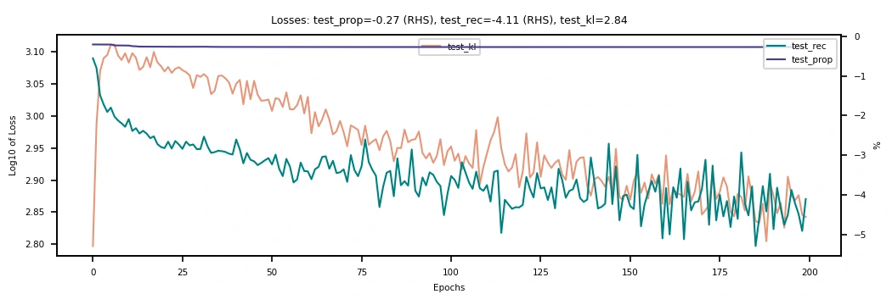</figure>
<figure><h4>With compression</h4>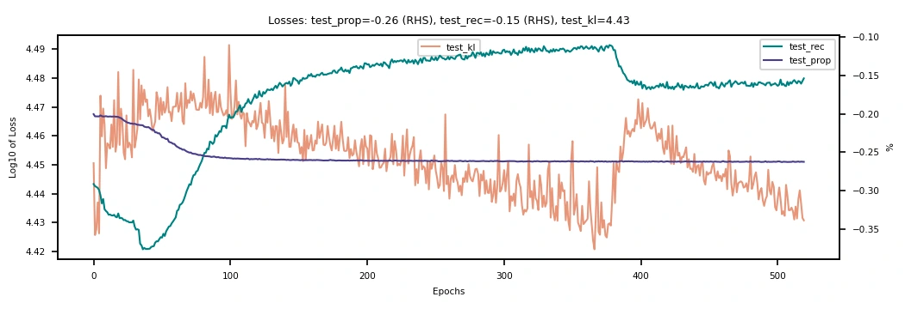<figcaption>Validation reconstruction, probability-prediction, and regularization losses on log10 scales.</figcaption></figure>
</details>
```

Each model was evaluated on 100 interpolation paths with 20 steps per path. Recording the largest normalized probability error along each path gives a lower mean peak error and a narrower distribution for the compressed run:

| Selected model checkpoint | Mean peak error | Standard deviation |
|:--|--:|--:|
| Without compression · epoch 200 | 0.245 | 0.075 |
| With compression · epoch 520 | 0.099 | 0.024 |

{fig-alt="Filled density curves showing lower and more concentrated interpolation peak errors with compression than without compression."}

**The compressed representation gives more coherent interpolation behaviour, while reconstruction quality deteriorates to some extent.** The numerical comparison supports better agreement between predicted and reference truth profiles along the decoded paths. Together with the displayed transitions, it motivates the next objective: preserve the interpolation gain while improving reconstruction.

This is the same kind of tension encountered in the earlier [image-based generation experiments](#generation): organizing a latent space for useful movement can compete with faithfully recovering an input. The connection is conceptual; the image and tree experiments do not establish identical quantitative effects. Better latent organization does not automatically imply better reconstruction fidelity.

The path error measures predictive agreement on each decoded tree. It does not measure tree-edit smoothness, fidelity to the original endpoint tree, or random-sampling quality. The two runs also differ in regularization strength and selected training epoch; these are exploratory validation results, not a matched multi-seed estimate of compression's effect.

<details class="ai-details">
<summary>How the comparison and error are defined</summary>

The models are compared at their selected checkpoints rather than simply at the end of training. The checkpoint criterion is the mean plus standard deviation of peak interpolation errors. Each illustrated path has a peak error close to the corresponding model’s mean. That criterion selects an illustrative score, not a statistically representative structure. Because interpolation errors also inform checkpoint selection, the table is a validation comparison rather than an independent test-set estimate.

For a decoded tree at step $k$, let $\widehat{\mathbf p}_{k}$ contain predicted probabilities at all internal nodes, including the root, and let $\mathbf p^{\rm ind}_{k}$ contain the corresponding formula-derived values. The score is

$$
e_k=\frac{\lVert\widehat{\mathbf p}_{k}-\mathbf p^{\rm ind}_{k}\rVert_2}
{\lVert\max(\mathbf p^{\rm ind}_{k},1-\mathbf p^{\rm ind}_{k})\rVert_2},
\qquad e_{\rm peak}=\max_{k=0,\ldots,19}e_k,
$$

where the maximum in the denominator is componentwise. This is a normalized Euclidean error, not mean squared error. All comparisons use the underlying probabilities; the tree drawings round values for readability. The two runs use different regularization strengths: $\beta=10^{-6}$ without compression and $\beta=4.75\times10^{-7}$ with compression. Both retain 512 latent dimensions.

</details>

#### The next step: retain continuity, improve reconstruction {#reasoning-next}

The immediate research goal is to **keep the interpolation-quality gain while improving reconstruction of the labelled logical trees**, alongside accurate prediction of their truth profiles. Both capabilities matter: interpolation supports exploration between examples, while reconstruction preserves the distinctions already present in the training objects.

This synthetic test exercises the general Logic VAE workflow and the witnessed-tree construction, with interpolation as the concrete capability evaluated. The longer-term aim is to generate new reasoning structures, explore alternative reasoning paths, and support planning and generative world models. Interpolation is a useful prerequisite for exploring that space, rather than validation of those broader applications.

These roles lead to separate tests. **Reconstruction** concerns recovery of an encoded object; **interpolation** concerns decoded behaviour between codes; **random sampling** concerns codes drawn without encoded endpoints; and **truth-profile prediction** concerns agreement with reference values for the generated structure. A low profile error alone does not establish that a tree is novel, that it reconstructs its source faithfully, or that it provides a successful plan.

The next perceptual extension replaces formula-generated training profiles with profiles supplied by the learned evaluator. Fixing one video and varying the reasoning would let us study alternative structures grounded in the same observation. Those profiles would incorporate correlations learned from perceptual data, including dependencies involving repeated events, instead of imposing the synthetic independent-copy prescription. Extending across observations also requires conditioning that retains the relevant perceptual evidence, since identical leaf marginals can conceal different dependencies.


### Relating different reasoning paths {#witnessed-relations}

The synthetic trees used in the experiments above are instances of this witnessed-path construction. Their repeated branches and dedicated witness concepts encode alternative reasoning paths and relations between those paths. This is the structural connection between the interpolation experiment and the homotopical research programme.

A rule can say more than that $A$ implies $C$. It can record *how* the reasoning goes from one to the other. Choose two intermediate concepts, $B$ and $B'$, and form the syntactic paths

$$
\Phi_B=(A\Rightarrow B)\wedge(B\Rightarrow C),\qquad
\Phi_{B'}=(A\Rightarrow B')\wedge(B'\Rightarrow C).
$$

Replacing both by $A\Rightarrow C$ would erase the choice of intermediate. Keeping the paths lets us ask a new question: **what witnesses their agreement?** In my homotopical construction a witness is itself an explicit atom, drawn from a dedicated vocabulary. The first witnessed block is

$$
P_1^k=(\Phi_B\Leftrightarrow W_k)\wedge(\Phi_{B'}\Leftrightarrow W_k).
$$

Both paths are compared with the *same* $W_k$. Choosing another witness gives a second way to relate the very same pair of paths. The drawing below shows the two paths horizontally and the two witnesses between them.

{width=75% fig-alt="Parallel paths from A to C, with witnesses alpha and alpha prime relating them."}

Now take two lower blocks, indexed by $k_1$ and $k_2$. They may differ in their earlier witnesses. One new witness relates them at the next level:

$$
P_{\ell+1}^{k}
=(P_\ell^{k_1}\Leftrightarrow W_k)\wedge(P_\ell^{k_2}\Leftrightarrow W_k),
\qquad \ell\geq 1.
$$

This is the sense in which the construction is higher-dimensional. First we have paths, then witnesses between paths, then witnesses between witnessed relations. Formula depth alone would count additional connectives without telling us *what kinds of objects* they relate. There is also a distinction between the structure we encode and the evidence that supports it. Under Boolean semantics the first block can be true when both paths and the witness are false. Reading a block as a positively supported explanation requires inspecting the witness and path values themselves.

In the interpolation experiment, these witnessed trees provide the structured inputs, and the independent-copy formulas provide the reference node probabilities. Decoding lets us inspect how their topology and labels change; the synchronized error curve tests how accurately the predictor follows the probabilities of those decoded structures. The experiment therefore connects the homotopical construction to a concrete generative-modelling test. It does not yet measure preservation of homotopy invariants or success in planning.

### A logical world model {#world-model}

Suppose a vocabulary distinguishes the current state, actions one could take, and later consequences. A goal can then be expressed as a formula. Holding the observed state fixed, we can ask which candidate action the model expects to make that goal more likely. A generative model can also estimate how plausible the proposed configuration is. Together these give us two reasons to examine a candidate: the clauses that support the goal, and whether the configuration resembles ones for which the system has evidence.

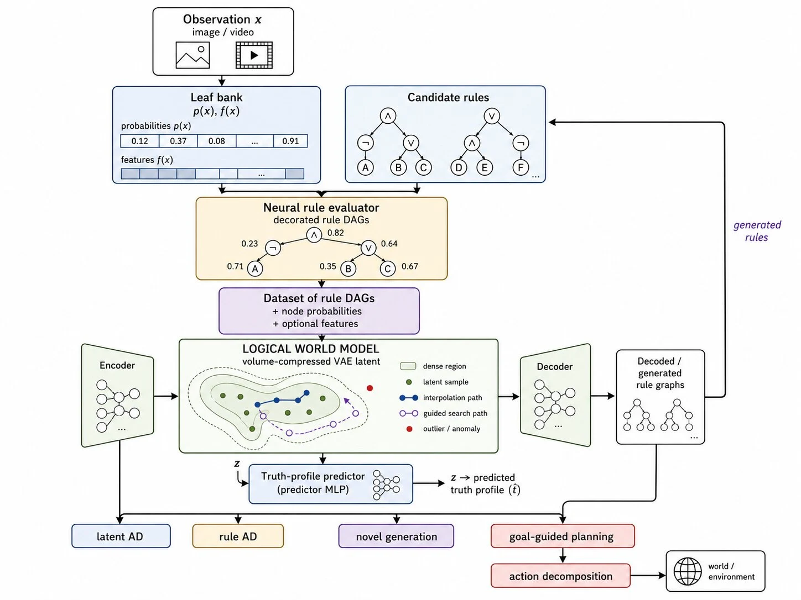{fig-alt="World-model schematic with a leaf bank, rule evaluator, encoder, latent predictor, decoder and generated rules."}

For example, a manipulation system might ask whether releasing a grasp now would leave an object supported. Changing an action atom provides a way to *pose* that question. Evidence from executed actions and their outcomes is what would justify interpreting the answer as a prediction of an intervention. Chimera pairs provide supervision for logical combinations; they cannot supply that evidence about the world. The proposed planning interface would expose which rules support a choice and allow their predictions to be tested against what subsequently happens.

### Searching for the concepts themselves {#ontology-search}

Everything above presupposes a vocabulary. To see what is at stake in choosing one, consider a small world with two routes between the same states: $A\to B\to C$ and $A\to D\to C$. Suppose $B$ and $D$ look similar. One candidate description distinguishes them, while another merges them. The experiment can be constructed so that both descriptions predict one-step observations equally well. Yet merging the intermediates collapses the two routes. A system can then lose the distinction needed even to *ask* how those routes are related.

In this programme an **ontology** specifies both the concepts available to a reasoning system and the abstraction map that connects observations to them. Changing the ontology changes what counts as a path, which witnesses can be distinguished, and which rules a generative model can express. We can therefore compare ontologies by the reasoning systems they support. A useful vocabulary might explain many stable consequences using relatively few concepts and relations. A larger vocabulary earns its cost only if its distinctions do useful work.

My proposed first test is a benchmark of **Hidden Higher-Structure Worlds**. The experimenter knows the states, paths, and higher relations by construction. The learner receives observations. Candidate abstractions can tie on local prediction while preserving different global structure. We can then ask whether measurements of the induced reasoning spaces, such as connected components or persistent cycles across evidence thresholds, help predict robustness or transfer beyond what prediction, complexity, and compression already tell us. If they add nothing on held-out worlds, that is evidence against using them as selection criteria.

A later meta-world-model would learn from completed ontology trials to estimate which concept systems deserve further investigation. The distinction from the Logic VAE is simple: the VAE searches for *reasonings within a vocabulary*. Ontology search changes *the vocabulary in which those reasonings can exist*. This brings us back to the opening question. Two descriptions may agree about what happens next. What else can each one explain, and what experiment would reveal a difference?

<!-- Additional witnessed-relation experiment figures belong in the subsection above, alongside their definitions. -->

## Further reading

- [Improving VAE generation with hyperspherical coordinates](https://arxiv.org/abs/2507.15900) and [anomaly detection from hypervolume-compressed latent space](https://arxiv.org/abs/2601.18823)
- [Phase structure and nested ordering in high-dimensional autoencoder latent spaces](https://arxiv.org/abs/2606.02600)
- [Testing the Test: Score-Direction Instability in Class-Split Anomaly Detection](https://arxiv.org/abs/2606.02601)
- [When Rule Violations Are Rare: Chimera Training for Logical Anomaly Detection](https://arxiv.org/abs/2605.26171)

<script src="../assets/ai-explorer.js?v=logic-vae-20261117" defer></script>
