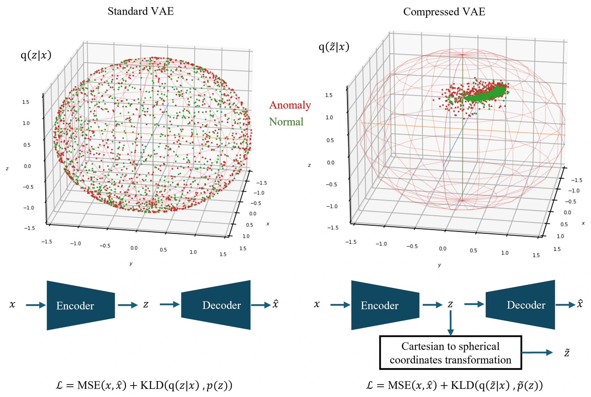
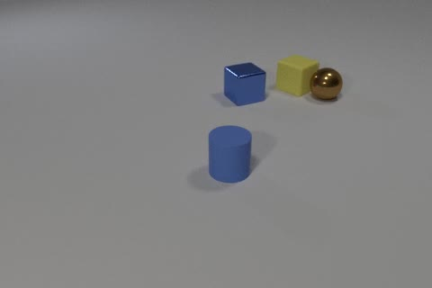
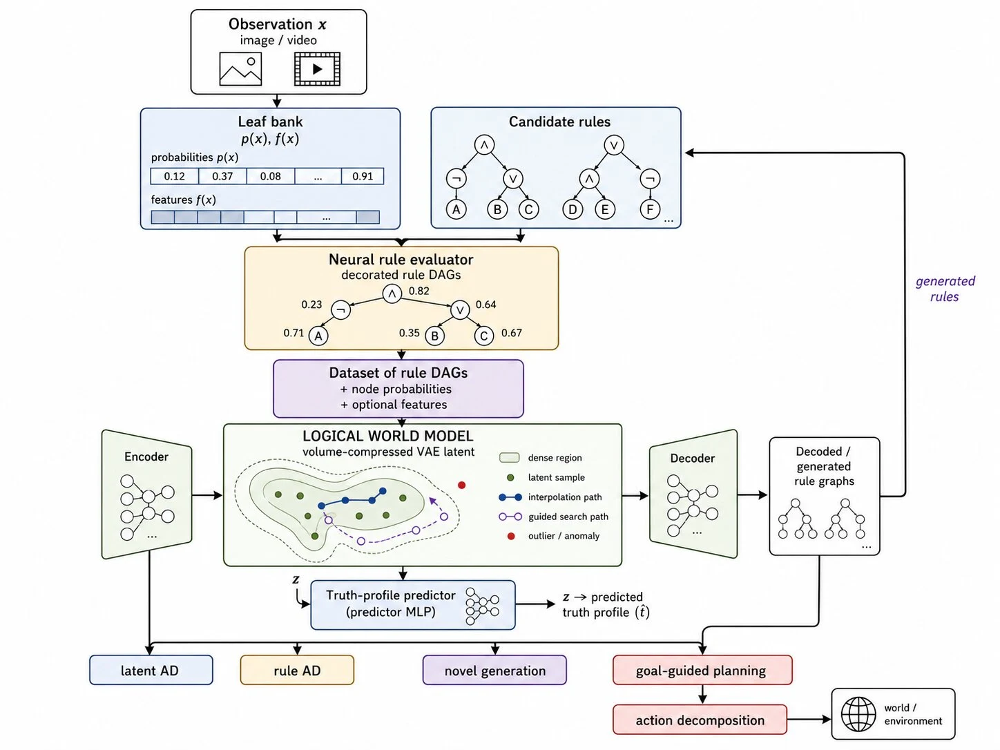

My AI research connects **the geometry of generative models** with **anomaly detection and structured reasoning**. My PhD's central work concerns high-dimensional VAE representations; logical evaluation and the Logic VAE extend that programme toward explicit, generative reasoning.

[Read the visual conceptual introduction →](ai-conceptual-foundations.qmd){.card-link}

```{=html}
<div class="ai-strands">
<a class="ai-strand" href="ai-conceptual-foundations.html#latent-geometry">

<span class="ai-strand-copy"><strong>Geometry &amp; anomalies</strong><small>Hyperspherical VAEs, generation, image and molecular AD, and the phase structure of learned representations.</small><span class="ai-read">Explore the VAE work →</span></span>
</a>
<a class="ai-strand" href="ai-conceptual-foundations.html#logical-anomalies">

<span class="ai-strand-copy"><strong>Logical violations</strong><small>Explicit expectations, learned neural evaluators, and chimera training when real rule violations are absent.</small><span class="ai-read">Watch the examples →</span></span>
</a>
<a class="ai-strand" href="ai-conceptual-foundations.html#generative-reasoning">

<span class="ai-strand-copy"><strong>Generative reasoning</strong><small>The Logic VAE, witnessed relations, and a research programme on world models and the search for ontologies.</small><span class="ai-read">Follow the next steps →</span></span>
</a>
</div>
```

## High-dimensional latent geometry

A VAE can reconstruct observations well while producing poor samples or unhelpful anomaly scores. My work investigates how the sparsity and angular organization of high-dimensional latent spaces contribute to this tension. Hyperspherical-coordinate regularization provides direct control over occupied hypervolume without reducing the latent dimension. The resulting representations are studied through generation, interpolation, and nearest-neighbour anomaly detection.

The statistical-physics strand introduces overlap distributions, angular observables, and [coarse-graining](ai-conceptual-foundations.qmd#coarse-representations) as diagnostics of latent organization. The central question is which partially ordered regimes preserve useful variation while supporting the task. The visual introduction includes galaxy examples, latent training animations, digit interpolations, and phase diagnostics from the thesis.

## Logical and semantic anomalies

Many anomalies concern a violated expectation: an event occurred without its expected context, or a relation between concepts failed. I develop neural evaluators that compile logical expressions into computation graphs and assess rule satisfaction from visual features. Chimera training constructs missing combinations of operand features, providing supervision for violations absent from the observed training data.

## Evaluation methodology

I also study failure modes in anomaly-detection benchmarks. Class-split protocols can exhibit score-direction instability when the designated anomaly class overlaps the normal mixture in representation space. This work distinguishes detector behaviour from effects of benchmark geometry.

## Structured world models

Ongoing work connects learned visual concepts, compositional rule graphs, and generative latent models with predictions of rule truth profiles. The compression VAE also enters this line of work. Witnessed relations record relationships between reasoning paths; ontology search asks how to choose the vocabulary in which such reasoning becomes possible.

[See AI publications →](../publications.qmd#artificial-intelligence){.card-link}
