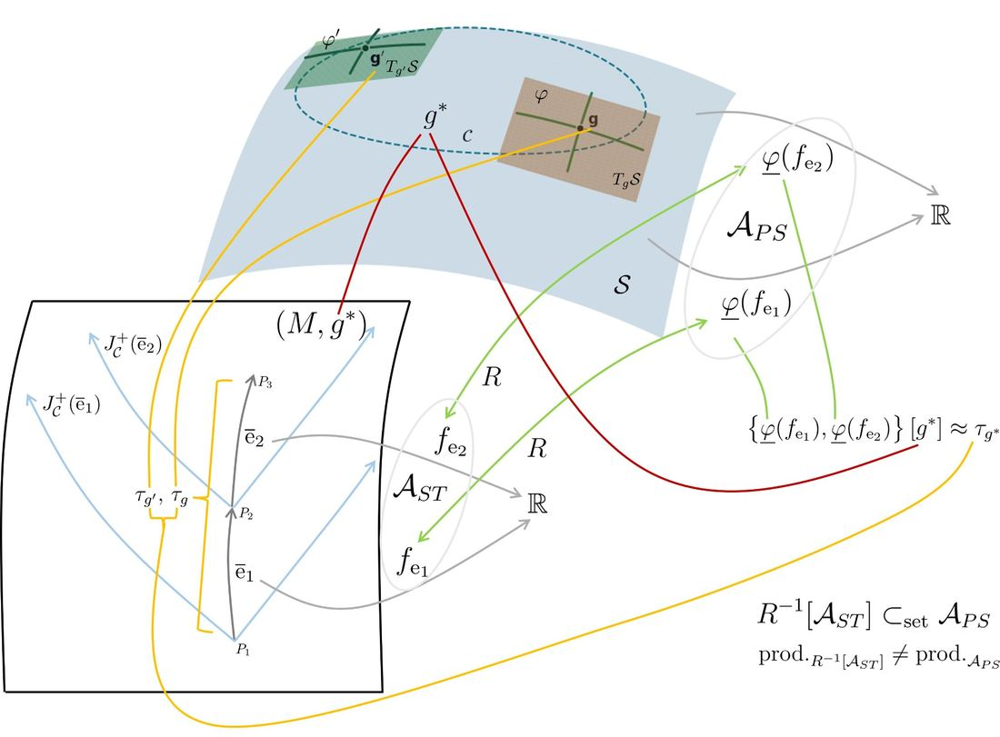
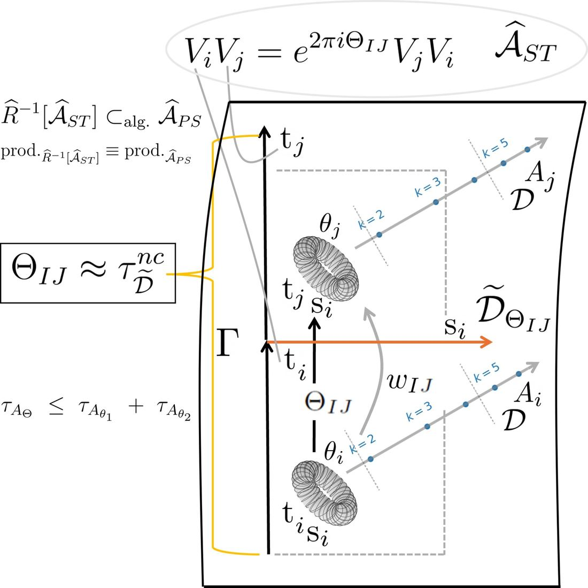

[← Mathematical Physics](mathematical-physics.qmd)

> **What this page is.** A self-contained conceptual introduction to the foundational idea behind Tor.QG. It is intended to explain the architecture of the theory without requiring the reader to first learn its full noncommutative-geometric machinery.

Toroidal Quantum Gravity (Tor.QG) is built around a question that is easy to state but surprisingly difficult to formulate consistently:

**If the gravitational field determines the causal and metric structure of spacetime, and that same gravitational geometry also enters the classical Poisson structure that one is supposed to quantize, what should replace this structure when the geometry itself becomes quantum?**

Tor.QG proposes a specific answer. Its central idea is not merely that spacetime should become noncommutative at very small scales, nor merely that time should become discrete, nor simply that geometry can be encoded by spectral triples. The more specific proposal is that

$$
\boxed{
\begin{gathered}
\text{quantum geometry itself participates in determining}
\\
\text{the noncommutation relations}
\\
\text{of quantum gravitational phase space.}
\end{gathered}
}
$$

At the same time, those noncommutation relations are incorporated into a noncommutative spectral geometry from which the corresponding local metric information—including a quantum notion of duration—can be recovered.

The resulting structure is intentionally self-consistent:

$$
\boxed{
\text{quantum geometry}
\longleftrightarrow
\text{quantum noncommutation}.
}
$$

This is the point that most easily gets lost when Tor.QG is interpreted using definitions imported from other approaches to quantum gravity.

## 1. The classical problem comes first

The motivation begins before noncommutative geometry enters.

In an ordinary field theory on a fixed spacetime, the background geometry is specified first. One then constructs the causal propagator, the Poisson brackets, and eventually the corresponding quantum commutators.

General Relativity is structurally different because the spacetime metric $g$ is itself the dynamical gravitational field.

In a covariant phase-space treatment of GR one constructs, for a given metric solution $g$, advanced and retarded Green operators

$$
G_g^\pm,
$$

and the causal propagator

$$
E_g=G_g^+-G_g^- .
$$

A corresponding symplectic structure takes the schematic form

$$
\sigma_g(f,h)
=
\int_M
f(x)\,(E_gh)(x)\,\epsilon(g),
$$

where both the causal propagator $E_g$ and the volume form $\epsilon(g)$ depend on the gravitational geometry.

Thus the relevant structure is not merely

$$
g\longmapsto\text{values of geometric observables}.
$$

Rather,

$$
\boxed{
g
\longmapsto
E_g
\longmapsto
\sigma_g
\longmapsto
\{\cdot,\cdot\}_g .
}
$$

The gravitational field participates in determining the Poisson structure itself.

This dependence also appears in the canonical formulation of GR, where the constraint algebra contains metric-dependent structure functions. Tor.QG uses the covariant formulation because the causal and temporal content of this dependence is considerably more transparent there (in this formulation, the Poisson bracket is often called the Peierls bracket and is common in modern treatments of QFT in curved spacetimes).

For observables associated with sufficiently small causally related spacetime processes, the construction developed in the Foundations paper isolates a dependence of their Poisson noncommutation on the causal geometry and, in particular, on the metric duration associated with the processes.

This structure is summarized schematically below (Figure 24 of the Foundations paper).

{#fig-torqg-classical-poisson width="95%" fig-alt="Diagram showing the causal and conformal-factor dependence of the classical gravitational Poisson noncommutation for observables associated with spacetime curve segments."}

The crucial question is then unavoidable:

$$
\boxed{
\begin{gathered}
\text{If geometry determines the classical Poisson structure,}
\\
\text{what determines the quantum commutator}
\\
\text{when geometry itself is quantum?}
\end{gathered}
}
$$

## 2. Why this produces a genuine quantum-gravity closure problem

Ordinary canonical quantization suggests schematically

$$
\{\mathcal O_1,\mathcal O_2\}_g
\quad\longrightarrow\quad
\frac{1}{i}
[\widehat{\mathcal O}_1,\widehat{\mathcal O}_2].
$$

But in gravity the object on the left already depends on $g$.

A naive procedure would therefore require the quantum commutator to depend somehow on the quantum gravitational geometry:

$$
[\widehat{\mathcal O}_1,\widehat{\mathcal O}_2]
=
\text{function of quantum geometry}.
$$

The difficulty is that the quantum geometry has not yet been defined. If its geometry is to be described by a noncommutative algebra, then the algebraic relations are needed in order to construct the quantum geometry in the first place.

One therefore encounters an apparent circle:

$$
\text{commutator}
\longleftarrow
\text{quantum duration},
$$

while simultaneously

$$
\text{quantum duration}
\longleftarrow
\text{quantum noncommutative geometry}.
$$

The quantity needed to define the algebra appears to be something that can only be calculated after the algebra and its geometry have already been constructed.

Tor.QG treats this not as an accidental technical problem, but as a reflection of the special character of gravity. In GR, unlike in a field theory on a fixed background, the object being quantized participates in defining the structure used to quantize it.

The goal is therefore not to eliminate this mutual dependence but to **close it consistently**.

## 3. What a Tor.QG micro-spacetime is

The elementary objects of Tor.QG are finite quantum spacetime processes, called **micro-spacetimes** or **micro-processes**.

A basic micro-spacetime $x$ contains a noncommutative two-torus

$$
A_{\theta(x)}
$$

equipped with spectral data,

$$
\bigl(A_{\theta(x)},H_x,D_{h_x}\bigr).
$$

The algebra is generated schematically by two unitaries $U,V$ satisfying

$$
UV
=
e^{2\pi i\theta(x)}
VU.
$$

One direction is interpreted as temporal and the other as spatial.

The Dirac operator $D_{h_x}$, including its Weyl or conformal dressing, carries the metric information of that micro-spacetime. Using the spectral geometry one defines its sheet area, and Tor.QG imposes the identification

$$
\boxed{
\theta(x)=\sqrt{\operatorname{Area}(x)}.
}
$$

The point is not merely that $A_{\theta(x)}$ happens to be noncommutative.

Its deformation parameter is tied to the metric geometry represented by its own spectral triple.

Schematically,

$$
D_{h_x}
\longrightarrow
\operatorname{Area}(x)
\longrightarrow
\theta(x)
\longrightarrow
UV=e^{2\pi i\theta(x)}VU.
$$

Thus the geometry and the amount of noncommutativity are already linked at the level of an individual micro-spacetime.

## 4. Phase space and spacetime are not being identified carelessly

A particularly important distinction is needed here.

Tor.QG introduces a larger noncommutative $n$-torus

$$
A_\Theta
=
C^*
\left\langle
U_1,\ldots,U_n
\;\middle|\;
U_iU_j=e^{2\pi i\Theta_{ij}}U_jU_i
\right\rangle ,
$$

which is interpreted as the **quantum phase space of gravitation**.

Individual micro-spacetimes occur inside it as embedded two-dimensional subtori,

$$
\iota_x:
A_{\theta(x)}
\hookrightarrow
A_\Theta .
$$

This produces two distinct but related readings.

In the **phase-space picture**, $A_{\theta(x)}$ is one microscopic gravitational configuration embedded in the larger quantum gravitational phase space.

In the **spacetime picture**, the spectral triple

$$
\bigl(A_{\theta(x)},H_x,D_{h_x}\bigr)
$$

is interpreted as the geometry of one actual quantum micro-spacetime.

Therefore the statement that Tor.QG relates the spacetime algebra and the phase-space algebra must not be read as saying that the entire global algebra $A_\Theta$ is itself one physical spacetime.

It is not.

The global object contains many possible microscopic geometries and their possible causal relations. In this sense it plays the role that classical gravitational phase space plays in GR: phase space contains different possible geometries; it is not itself one of those geometries.

The correct schematic picture is

$$
\boxed{
A_{\theta(x)}
\subset
A_\Theta,
}
$$

with

$$
\begin{array}{ll}
A_{\theta(x)}:
&
\text{one quantum micro-spacetime in the spacetime picture},
\\[1mm]
A_\Theta:
&
\text{the larger quantum gravitational phase-space algebra}.
\end{array}
$$

Changing the metric data of a micro-spacetime therefore corresponds to moving to another micro-geometric configuration in phase space. It is not the introduction of a new external background.

## 5. Why the spacetime product and the quantum operator product meet

There is another unusual ingredient.

Classically, spacetime functions and functionals on gravitational phase space are mathematically different objects. Tor.QG begins from specially constructed phase-space functionals associated with small spacetime processes and then considers their quantization.

The proposal is that, after quantization, the product carrying the spacetime information and the operator product carrying the quantum phase-space information become represented by one noncommutative product.

This is the step that allows the nonzero Poisson brackets of the gravitational phase-space construction to induce noncommutation of the corresponding quantum spacetime algebra.

Consequently, the NC two-torus is not introduced merely as an arbitrary model of “fuzzy spacetime.” It arises as the algebraic structure obtained after exponentiating the quantized generators associated with the selected spacetime-supported phase-space observables.

In this precise sense, the quantum spacetime algebra becomes an embedded part of the quantum gravitational phase-space algebra.

This is a deliberate attempt to preserve, after quantization, information that in classical GR is distributed between two descriptions:

$$
\text{phase space containing all possible geometries}
$$
and

$$
\text{one spacetime geometry obtained after selecting a solution}.
$$

## 6. Two micro-spacetimes and causal cross-noncommutation

The next step is to consider two micro-spacetimes.

Their individual NC two-tori occupy diagonal blocks of the larger matrix $\Theta$. But a higher-dimensional noncommutative torus can also contain **off-diagonal noncommutation** between generators belonging to different micro-spacetimes.

This is crucial.

If $x$ and $y$ are two micro-spacetimes, Tor.QG associates a possible causal relation between them with nonzero cross-noncommutation between their temporal sectors.

Thus causal adjacency is encoded algebraically:

$$
\boxed{
\begin{gathered}
x\text{ causally adjacent to }y
\quad\Longleftrightarrow\quad
\\
\text{appropriate cross-noncommutation is nonzero}.
\end{gathered}
}
$$

An orientation and partial order are then added so that the resulting adjacency structure becomes a causal set.

The relevant off-diagonal deformation parameter is not introduced independently of the individual geometries. In the basic axiomatic construction it is tied to the metric scales of the two participating sheets,

$$
\Theta_{xy}
=
\theta(x)+\theta(y)
=
\sqrt{\operatorname{Area}(x)}
+
\sqrt{\operatorname{Area}(y)} .
$$

Hence the global phase-space noncommutation structure is controlled internally by the geometric data of its micro-spacetime sectors.

This is the intended quantum counterpart of the metric dependence of the classical gravitational Poisson structure.

## 7. At this point, why call any of this physical time?

Up to this stage there is an obvious possible objection.

One has a noncommutative parameter associated with a causal transition. One has also motivated, from classical GR, why a duration should control the relevant Poisson noncommutation.

But motivation is not enough.

One cannot simply declare

$$
\Theta=\text{time}
$$

and regard the problem as solved.

A deformation parameter is not automatically a physical duration.

This is why the later transition geometry of Tor.QG is important.

## 8. Giving the transition itself a spectral geometry

Section 8 of the Foundations construction starts again with two NC two-tori representing two micro-spacetimes,

$$
A_{\theta_1},
\qquad
A_{\theta_2}.
$$

They are glued along a common spatial circle using an amalgamated construction. Their mutual cross-noncommutation is then introduced through a deformation of the glued geometry.

The result is no longer merely two spectral triples plus an abstract statement that they should be causally related.

One has constructed an algebraic object representing the **transition sheet itself**.

A diagonal Dirac calculus on this glued geometry is insufficient to detect the relevant cross phase. Tor.QG therefore introduces an off-diagonal bridge contribution to the Dirac operator, built from the cross generators. This makes commutators with the Dirac operator sensitive to the same algebraic deformation that characterizes the transition.

Consequently, the corresponding Connes spectral distance between suitable states on the two sheets becomes sensitive to the cross-noncommutation parameter.

One can therefore calculate an actual noncommutative metric separation in the transition direction:

$$
\boxed{
\tau_\Theta
=
d_{\widetilde D_\Theta}(\varphi,\psi):=\sup\{\,|\varphi(a)-\psi(a)|:\ a=a^*,\ \|[\widetilde D_\Theta,a]\|\le 1\,\}.
}
$$

For the first mode, the construction gives explicit bounds of the form

$$
\frac{\sqrt{\Theta}}
     {2|\sin(\pi\Theta)|}
\leq
\tau_\Theta
\leq
\frac{\sqrt{2}\sqrt{\Theta}}
     {2|\sin(\pi\Theta)|}
$$

in the relevant branch of the parameter range.

The important point is **not** that

$$
\tau_\Theta=\Theta
$$

as an exact algebraic identity for every value of the parameters. That would be an oversimplification.

The important point is that the transition noncommutation and the transition metric distance are now parts of the **same constructed noncommutative geometry**. Through the bridge calibration, the cross deformation that characterizes the algebraic relation also controls the spectral distance across the transition.

The proposed temporal interpretation is therefore no longer an arbitrary relabeling of a deformation parameter.

## 9. What makes this spectral distance a candidate for physical time

Noncommutative geometry already possesses spectral notions of distance. Therefore obtaining a Connes distance is, by itself, not enough to establish that a particular distance is physical time.

Tor.QG's argument is stronger because several independent pieces are intended to meet:

$$
\boxed{
\begin{gathered}
\text{causal relation}
+
\text{geometry-dependent cross noncommutation}
\\
+
\text{spectral transition distance}
\\
+
\text{classical GR Poisson-bracket motivation}.
\end{gathered}
}
$$

The causal structure identifies the relevant direction as temporal.

The classical covariant phase-space analysis says that the metric duration of the causal process is precisely the kind of geometric information that should regulate the corresponding Poisson noncommutation.

The quantum theory replaces the classical process with a noncommutative transition geometry.

The spectral triple of that transition then supplies an intrinsic metric duration without referring back to a classical spacetime metric.

And the same transition geometry contains the cross-noncommutation whose classical ancestor was supposed to depend on that duration.

The construction therefore closes as

$$
\boxed{
\begin{gathered}
\text{GR causal/metric duration}
\longrightarrow
\text{classical Poisson noncommutation}
\\[2mm]
\downarrow\ \text{quantization}
\\[2mm]
\text{NC spectral duration}
\longleftrightarrow
\text{quantum cross-noncommutation}.
\end{gathered}
}
$$

{#fig-torqg-quantum-closure width="95%" fig-alt="Diagram of the Tor.QG quantum construction relating spectral quantum geometry, cross-noncommutation and the intrinsic duration of a causal transition."}

This two-way consistency is the central conceptual point.

The duration is not physical merely because NCG can define a distance.

It is physical in the Tor.QG construction because the distance occupies the same structural role that the metric duration occupied in the classical gravitational Poisson problem that motivated the quantization.

## 10. This is not ordinary background dependence

At this stage another common objection can arise:

> If the algebraic noncommutation depends on geometry, is the construction not background-dependent?

That conclusion follows only if one assumes in advance a particular definition of background independence.

Tor.QG does **not** define background independence to mean that there must exist one abstract algebra whose multiplication law is entirely independent of gravitational geometry.

That is a useful criterion in some algebraic approaches, but it is not the criterion being quantized here.

The classical starting point already contains

$$
g
\longmapsto
\{\cdot,\cdot\}_g.
$$

Demanding instead that the quantum algebra be completely geometry-independent would remove precisely the dependence that Tor.QG is trying to preserve from GR.

The distinction that matters is between

$$
\boxed{
\begin{gathered}
\text{dependence on an externally prescribed}
\\
\text{background}
\end{gathered}
}
$$

and

$$
\boxed{
\begin{gathered}
\text{internal dependence on the dynamical}
\\
\text{gravitational configuration}.
\end{gathered}
}
$$

These are not the same thing.

A quantum field theory formulated on one externally selected classical metric,

$$
(M,g_0),
$$

is background-dependent in the ordinary sense that $g_0$ has been supplied before the quantum dynamics is defined.

Tor.QG does not introduce such a metric.

Instead, different metric configurations occur as different micro-geometric sectors inside the gravitational phase-space structure itself. Their metric data determine their deformation data, and all of these possible configurations belong to the theory.

Thus the statement

$$
\text{the noncommutation depends on geometry}
$$

does not mean

$$
\text{the theory depends on one external background geometry}.
$$

It means

$$
\boxed{
\begin{gathered}
\text{different gravitational configurations carry}
\\
\text{the algebraic structures appropriate}
\\
\text{to their own quantum geometry}.
\end{gathered}
}
$$

This is deliberate.

::: {.callout-important appearance="simple"}
**Tor.QG does not seek a geometry-independent quantum algebra. It attempts to quantize the geometry dependence of the gravitational Poisson structure itself.**
:::

## 11. Nor is this the claim that one algebra changes its commutator as external time passes

Another misleading interpretation would be:

> Tor.QG contains one algebra whose commutation relations change with time.

That is also not the construction.

The global algebra $A_\Theta$ is the quantum gravitational phase-space object. Its embedded micro-spacetime sectors encode different possible geometric data and their causal relations.

A change of the metric configuration therefore corresponds to a transition among geometric sectors of quantum gravitational phase space, not to an externally driven modification of an algebra sitting on a pre-existing time axis.

There is no prior external time $t$ for which one writes

$$
[A,B]_t
$$

and then prescribes how this bracket changes.

Microscopic time is itself one of the geometric quantities being constructed.

## 12. Nor is Tor.QG simply “a fixed algebra with geometry in the states”

Another familiar possibility is to demand one abstract algebra

$$
\mathcal A
$$

while representing different geometries by different states or Hilbert-space representations,

$$
\omega
\mapsto
(\mathcal H_\omega,\pi_\omega).
$$

This is an important idea in algebraic approaches to background independence.
But it is not what Tor.QG is trying to reproduce.

Tor.QG begins from the observation that the gravitational field affects the classical Poisson structure itself. Its quantum analogue therefore permits the geometric configuration to enter the deformation structure of the algebra.

One can prefer a different definition of background independence, but that is then a comparison between two different architectural principles. It is not by itself a demonstration of inconsistency in Tor.QG.

A fair comparison must first acknowledge that Tor.QG deliberately proposes

$$
\boxed{
\text{geometry-dependent quantum algebraic structure}
}
$$

as the analogue of

$$
\boxed{
\text{geometry-dependent classical gravitational Poisson structure}.
}
$$

Only after recognizing that premise can one meaningfully ask whether the proposed implementation succeeds.

## 13. Why this is not a vicious mathematical circle

The mutual dependence

$$
\text{geometry}
\longleftrightarrow
\text{noncommutation}
$$

can look circular.

There is, however, an important difference between a circular **definition** and a self-consistency **condition**.

Tor.QG is not defined recursively by saying:

1. calculate the duration from an unknown algebra;
2. use that duration to define the unknown algebra;
3. repeat indefinitely.

The quantum theory is first given through mathematically specified algebraic and spectral data: the global NC torus, its embedded micro-spacetimes, their spectral triples, cross relations, causal order, and later the glued transition geometry.

The classical GR argument explains **why this particular architecture is sought**.

Once the quantum construction exists independently, one can then test whether the geometric quantities extracted from it possess the interpretation that motivated the axioms.

Section 8 performs precisely this kind of internal check. The transition is built as an actual noncommutative spectral geometry, and its spectral distance is shown to depend on the same cross structure that defines the transition algebra.

Thus the logical structure is closer to solving a coupled system,

$$
X=F(Y),
\qquad
Y=G(X),
$$

than to defining $X$ by assuming $X$.

Physics routinely contains quantities that determine one another through coupled consistency equations. Mutual dependence is not logical circularity provided the combined structure is independently well-defined and admits solutions.

## 14. What is genuinely unusual here

Many ingredients of Tor.QG have relatives elsewhere.

Noncommutative spacetimes have a large literature.

Spectral triples encode geometry through operators.

Discrete causal structures appear in causal-set theory.

Geometry-dependent structures appear throughout GR.

Emergent and relational notions of time have been proposed in many forms.

None of these statements by itself identifies the distinctive Tor.QG mechanism.

The unusual conjunction is this:

$$
\boxed{
\begin{gathered}
\text{the metric structure of each microscopic}
\\
\text{quantum spacetime is encoded spectrally;}
\\[1mm]
\text{that geometric information controls}
\\
\text{deformation parameters inside the quantum}
\\
\text{gravitational phase-space algebra;}
\\[1mm]
\text{cross-noncommutation between microscopic}
\\
\text{geometries encodes their possible causal transition;}
\\[1mm]
\text{the transition itself is then equipped}
\\
\text{with spectral geometry;}
\\[1mm]
\text{and the corresponding NC metric recovers}
\\
\text{an intrinsic duration associated}
\\
\text{with that same cross structure.}
\end{gathered}
}
$$

The resulting proposal is therefore not simply

$$
\text{quantize spacetime}.
$$

It is closer to

$$
\boxed{
\begin{gathered}
\text{quantize the relation between gravitational geometry}
\\
\text{and the algebraic structure used}
\\
\text{to describe gravitational observables.}
\end{gathered}
}
$$

## 15. Four common misreadings

Because the construction differs from several standard frameworks, four interpretations should be explicitly avoided.

### Misreading 1: “Tor.QG is just QFT on a noncommutative background.”

No. A deformation parameter is not chosen first to define a fixed NC spacetime on which fields subsequently propagate. The deformation parameters are tied to the microscopic gravitational geometry itself, and the collection of possible micro-geometries forms gravitational phase space.

### Misreading 2: “Geometry-dependent commutators prove that Tor.QG is background-dependent.”

No. They show that the algebraic structure depends on the gravitational configuration. That dependence is intentional and motivated by the geometry dependence of the classical GR Poisson structure. There is no external classical metric controlling all configurations.

### Misreading 3: “Tor.QG simply calls a Connes distance ‘time’.”

No. The temporal interpretation also uses causal orientation, the classical covariant Poisson structure, the cross-noncommutation of timelike sectors, and the explicit spectral geometry of the transition. The Connes distance supplies the intrinsic metric realization of a temporal quantity whose structural role was already independently motivated.

### Misreading 4: “The global NC torus is supposed to be one gigantic physical spacetime.”

No. The global $A_\Theta$ is the quantum gravitational phase-space algebra. Individual embedded NC two-tori, equipped with their spectral data, receive the micro-spacetime interpretation. The phase space contains many possible geometries just as classical gravitational phase space does.

## 16. What is claimed, and what is not

It is also useful to separate the structural proposal from stronger physical claims.

Tor.QG claims to provide a mathematically defined framework in which quantum micro-geometries, causal relations, noncommutation and intrinsic duration can be tied together in the manner described above.

It proposes this structure as a quantum analogue of the geometry dependence of gravitational Poisson brackets.

It does **not** follow merely from this conceptual closure that Tor.QG is the correct theory of quantum gravity.

That requires additional questions: consistency of the complete dynamics, the classical limit, matter coupling, phenomenology, and ultimately confrontation with observation.

Likewise, showing that the spectral transition distance is controlled by the cross deformation does not establish an exact identity between every deformation parameter and every physical proper-time observable in arbitrary circumstances. The specific spectral construction and its calibration determine the relation.

These qualifications are important because they separate two different questions:

$$
\boxed{
\text{Is the conceptual architecture internally meaningful?}
}
$$

and

$$
\boxed{
\text{Does nature actually use this architecture?}
}
$$

The first is a mathematical and conceptual question. The second is a physical one.

## 17. The entire proposal in one diagram

The foundational logic of Tor.QG can be compressed into the following chain:

$$
\boxed{
\begin{gathered}
\text{dynamical metric in GR}
\\
\downarrow
\\
\text{geometry-dependent causal propagator}
\\
\downarrow
\\
\text{geometry-dependent Poisson structure}
\\
\downarrow
\\
\text{requirement of geometry-dependent}
\\
\text{quantum noncommutation}
\\
\downarrow
\\
\text{NC gravitational phase-space algebra }A_\Theta
\\
\downarrow
\\
\text{embedded spectral micro-spacetimes}
\\
\downarrow
\\
\text{cross-noncommuting causal transitions}
\\
\downarrow
\\
\text{spectral geometry of the glued transition}
\\
\downarrow
\\
\text{intrinsic NC transition distance}
\\
\downarrow
\\
\text{quantum duration}.
\end{gathered}
}
$$

The final step returns to the quantity that motivated the quantum noncommutation in the first place.

That is the closure Tor.QG is designed to achieve.

## 18. The shortest possible statement of the idea

If the whole construction had to be summarized in a few sentences, they would be these:

In General Relativity, geometry does more than provide values of lengths and times: it participates in determining the causal and Poisson structure of the gravitational theory. Tor.QG attempts to preserve that fact after quantization. Its microscopic spectral geometries determine quantities that control the noncommutation structure of quantum gravitational phase space, while causal cross-noncommutation is itself incorporated into a spectral transition geometry from which an intrinsic quantum duration can be calculated.

Thus, in Tor.QG,

$$
\boxed{
\begin{gathered}
\text{quantum geometry does not merely inhabit}
\\
\text{the quantum theory; it participates in determining}
\\
\text{the algebraic relations of the theory itself.}
\end{gathered}
}
$$

The resulting geometry dependence is not an externally imposed background. It is part of the gravitational configuration space being quantized.

And the resulting notion of time is not simply an arbitrary spectral distance. It is the spectral realization, inside the quantum theory, of the same geometric quantity whose role in the classical gravitational Poisson structure motivated the noncommutation in the first place.

That is the foundational idea.

## Postscript: Why noncommutative tori appear — and what they are not meant to mean

The word **toroidal** can itself invite one final misunderstanding.

Tor.QG does not require the ontological claim that a fundamental quantum region of spacetime is literally a tiny torus, in the ordinary topological sense, or that microscopic spacetime is obtained by taking a classical torus and simply “making its coordinates noncommute.”

The appearance of the noncommutative torus is more indirect and is tied to the quantization procedure.

At the classical stage, Tor.QG starts with functions associated with small spacetime processes and with the corresponding functionals on gravitational phase space. In order not to carry the full classical spacetime continuum unchanged into the quantum theory, the variables selected for quantization are reduced so that, on the relevant process, they no longer resolve arbitrary continuum variation. Their remaining labels are then discretized,

$$
k\in\mathbb R
\quad\longrightarrow\quad
k\in\mathbb Z.
$$

The selected classical phase-space functionals possess a nonzero Poisson bracket,

$$
\{\phi_1,\phi_2\}
=
\theta .
$$

Canonical quantization turns this into an operator commutation relation. Passing to bounded Weyl generators,

$$
U=e^{i\widehat\phi_1},
\qquad
V=e^{i\widehat\phi_2},
$$

then gives

$$
UV
=
e^{2\pi i\theta}
VU .
$$

Because the discretized integer labels become powers $U^mV^n$, with

$$
m,n\in\mathbb Z,
$$

the resulting algebra is precisely the algebraic structure of a noncommutative two-torus.

Thus the logical order is

$$
\boxed{
\begin{gathered}
\text{classical spacetime-supported variables}
\longrightarrow
\text{phase-space functionals}
\\
\longrightarrow
\text{discretized labels}
\longrightarrow
\text{Poisson bracket}
\\
\longrightarrow
\text{Weyl quantization}
\longrightarrow
A_\theta .
\end{gathered}
}
$$

The NC torus is therefore not chosen because one first postulates that microscopic spacetime has toroidal topology. It is the algebra that emerges from the particular variables and Weyl relations produced by the Tor.QG quantization scheme.

This distinction becomes especially important when considering the formal commutative limit.

For the abstract noncommutative torus,

$$
\theta\rightarrow0
$$

gives the commutative algebra

$$
C(\mathbb T^2),
$$

corresponding mathematically to an ordinary continuous two-torus.

A literal ontological reading would then suggest that the $\theta\to0$ limit of a Tor.QG micro-spacetime must be an ordinary classical toroidal region. That is **not** the intended interpretation.

The reason is that the continuum implicit in the abstract algebra $C(\mathbb T^2)$ did not enter Tor.QG as the physical microscopic spacetime continuum in the first place. The classical variables were deliberately stripped of their unrestricted continuum range and discretized before the NC-torus Weyl algebra was obtained. The integers appearing after quantization label powers of Weyl generators; they are not points of an underlying classical toroidal lattice, and the continuous topology recovered when the abstract deformation parameter is set to zero should not simply be reidentified with the classical spacetime continuum that the construction deliberately avoided carrying through the quantization.

Accordingly,

$$
\boxed{
\begin{gathered}
A_\theta\ \text{is the mathematical spectral model}
\\
\text{used for a quantum micro-spacetime,}
\\
\text{not a claim that the micro-spacetime is literally}
\\
\text{a classical torus with noncommuting coordinates.}
\end{gathered}
}
$$

For the same reason, the periodicity inherent in the torus algebra should not automatically be interpreted as a physical periodic identification of microscopic space or time.

The word *toroidal* describes the algebraic form that the quantized relations take.

It does not, by itself, assert a microscopic toroidal topology.

This point also prevents a misleading use of the commutative limit. The fact that the abstract NC torus has

$$
A_\theta
\xrightarrow{\theta\to0}
C(\mathbb T^2)
$$

is a mathematical property of the deformation family. It does **not** mean that the physical classical limit of Tor.QG is obtained simply by setting every noncommutativity parameter to zero and interpreting the result as a collection of ordinary two-tori.

The physical classical limit is a separate coarse-graining problem: many quantum micro-processes, their causal relations, spectral metric data and discrete transports must collectively give rise to an effective continuum spacetime geometry.

Thus two limits must not be confused:

$$
\boxed{
\begin{gathered}
\theta\to0:
\quad
\text{commutative limit of the abstract torus algebra}
\\[2mm]
\text{Tor.QG coarse graining:}
\\
\text{emergence of classical spacetime from many micro-processes}.
\end{gathered}
}
$$

They are conceptually different operations.

::: {.callout-important appearance="simple"}
**The NC torus is the mathematical algebraic/spectral model of the micro-process; Tor.QG does not assert that microscopic spacetime is literally a tiny torus.**
:::

This is also why the terminology **micro-spacetime modeled by an NC torus** is preferable to the stronger statement that **a micro-spacetime literally is a torus**.

The torus is the algebraic language in which the quantized relations close. The physical object is the quantum gravitational process represented by that algebra together with its spectral, causal and dynamical data.

## A glimpse of the physics

The construction above is not intended to remain purely kinematical. One of its first applications appears in black-hole thermodynamics.

Because a Tor.QG transition carries an intrinsic quantum duration, its noncommutative geometric action also defines an intrinsic quantity conjugate to that time. Passing from the local inertial description to the accelerated time flow appropriate near a horizon leads, after the corresponding geometric normalization, to the familiar local horizon energy

$$
E_{\rm hor}
=
\frac{\kappa A}{8\pi}.
$$

What is unusual is its origin. In Tor.QG this expression is not introduced by first taking the classical horizon energy and then replacing its area by a quantum area operator. It descends from the microscopic quantum spacetime construction itself.

The same framework also gives two independent estimates of a smallest allowed microscopic duration: one from the spectral geometry of the glued causal transition and another from the effective transition dynamics together with probability normalization. Their values are close,

$$
\tau_{\rm kin}\simeq0.331,
\qquad
\tau_{\rm dyn}\simeq0.300.
$$

Using their mean microscopic scale in the accelerated-time relation produces

$$
\gamma_{\rm eff}
=
\ln(1+\bar\tau_{\min})
\simeq0.274,
$$

numerically close to the value of the Immirzi parameter that appears in the standard loop-quantum-gravity black-hole entropy calculation.

Tor.QG therefore suggests a different interpretation of that number: rather than being merely an otherwise free quantization normalization fixed by black-hole entropy, it may encode the accelerated image of a fundamental quantum time gap.

The subsequent black-hole entropy calculation uses the familiar horizon-state counting machinery and recovers the standard leading relation

$$
S_{\rm BH}=\frac{A_H}{4}+\cdots .
$$

The claim is therefore not that Tor.QG invents a new entropy-counting argument. The new element lies earlier in the chain: the microscopic theory supplies an independent geometric origin for the horizon energy and for the normalization entering the counting.

This is one example of the general strategy of the programme:

$$
\boxed{
\begin{gathered}
\text{microscopic quantum spacetime structure}
\longrightarrow
\text{intrinsic time and energy}
\\
\longrightarrow
\text{statistical mechanics}
\longrightarrow
\text{macroscopic gravitational physics}.
\end{gathered}
}
$$

The companion applications work explores the same route much further, including radiation-dominated cosmology, a near-critical geometric mechanism for inflation, and the interior of evaporating black holes.

## Further reading

- [Tor.QG I — Foundations](https://doi.org/10.1088/1361-6382/ae85a6)
- [Expanded Foundations version](https://drive.google.com/file/d/1-1EKsX6AGEPTgjHvUbKXGnUF7QUXDqMe/view?usp=sharing)
- [Mathematical-physics publications](../publications.qmd#mathematical-physics)

[← Back to Mathematical Physics](mathematical-physics.qmd)
