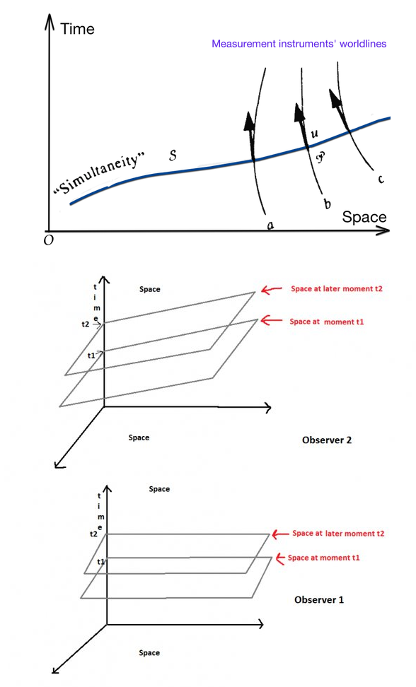

[← All writings](../index.qmd){.writing-back}

Not necessarily. In general relativity, the geometry directly governed by Einstein's field equations is that of spacetime: the four-dimensional entity combining space and time. Solutions of these equations describe spacetime geometries together with their matter content. Different matter configurations generally give different geometries, and vacuum solutions can also have curvature.

Suppose we solve the equations in a particular case and obtain a cosmological solution with a Friedmann–Lemaître–Robertson–Walker (FLRW) metric.

For a typical cosmological solution, the spacetime curvature is non-zero. But what about space? Is space curved?

To answer this, we first need to define what “space” means in this context, and this is not trivial. General relativity gives us a spacetime geometry, but it does not generally provide a unique decomposition into space and time. Different observers, following different spacetime trajectories or worldlines, can measure different amounts of elapsed proper time. Their notions of simultaneity can also differ. We identify suitable spacelike hypersurfaces of simultaneity as “space” in a chosen description. This decomposition is called a “slicing” of spacetime into space and time. Different choices can give different slicings:

{width=588 fig-alt="A curved spatial slice intersects three instrument worldlines; two lower diagrams show observers using differently tilted simultaneity slices."}

The slicing is therefore not fixed by the spacetime geometry alone: one must specify the chosen foliation or simultaneity prescription. By “observer” here, I do not mean that an actual human being has to be present. One can think of a family of idealized measuring instruments, or simply a choice of spacelike slices with adapted coordinates. An arbitrary observer family need not admit hypersurfaces everywhere orthogonal to its worldlines, so this identification requires some care. The remark at the end discusses a consequence for the Hamiltonian formulation.

There are general equations relating these geometries. Let $g_{ab}$ be the spacetime metric, with signature $(-,+,+,+)$, and let $R^a{}_{bcd}$ denote its Riemann curvature tensor. Spacetime is flat when this tensor vanishes. For a spacelike hypersurface with unit timelike normal $n^a$, the induced metric and tangential projector are

$$
h_{ab}=g_{ab}+n_a n_b,
\qquad
h^a{}_b=\delta^a{}_b+n^a n_b.
$$

Let ${}^{(3)}R_{abcd}$ be the intrinsic Riemann curvature tensor of the hypersurface. The Gauss equation, one of the Gauss–Codazzi relations, reads

$$
{}^{(3)}R_{abcd}
=
h_a{}^e h_b{}^f h_c{}^g h_d{}^h R_{efgh}
-K_{ac}K_{bd}+K_{ad}K_{bc},
$$

where, with our sign convention,

$$
K_{ab}\doteq\frac12\mathcal L_n h_{ab}
$$

is the extrinsic curvature and $\mathcal L_n$ denotes the Lie derivative along the normal. Here the Riemann convention is $[\nabla_c,\nabla_d]v^a=R^a{}_{bcd}v^b$, and the displayed extrinsic-curvature equation is understood on tangential components. We say that the spatial geometry is curved when its intrinsic Riemann tensor is non-zero.

It follows that even if spacetime is flat, $R_{abcd}=0$, a spatial slice can be curved because of its extrinsic curvature. Conversely, a flat spatial slice, ${}^{(3)}R_{abcd}=0$, does not imply flat spacetime: the projected spacetime curvature and extrinsic-curvature terms can cancel. The following is an example of the latter case.

Return to the FLRW cosmological solutions. These geometries have a preferred family of comoving observers, also called isotropic observers. The spatial slices associated with them are homogeneous and isotropic, as assumed in the standard cosmological description. Galaxies approximately follow these worldlines when their peculiar motions are neglected. The time measured by these observers is the cosmic time used when speaking of the age of the universe. Their spatial slices describe the “universe at a given time”.

What is the geometry of these slices? The FLRW geometries are classified by a normalized spatial-curvature parameter $k$. Under the assumptions of homogeneity and isotropy, the three possibilities are $k=+1$, $k=0$, and $k=-1$. Their simply connected spatial models are, respectively, a three-sphere, Euclidean three-space, and hyperbolic three-space. These statements concern the local constant-curvature geometry; other global topologies can be obtained through suitable identifications. The cases $k=+1$ and $k=-1$ are the non-Euclidean ones.

Thus, curved spacetime can have either curved or flat spatial slices. FLRW spacetime is generally curved, although the family also includes special flat-spacetime cases, such as Minkowski spacetime in Milne coordinates.

Observations are consistent with spatial geometry close to flat on cosmological scales. For example, the [Planck 2018 analysis combined with baryon acoustic oscillation data](https://arxiv.org/abs/1807.06209) found a spatial-curvature constraint consistent with the $k=0$ case. This does not establish exact flatness or determine global topology.

As a final example, consider the spatially flat case, $k=0$. For an expanding FLRW solution, spacetime can be curved while each constant-cosmic-time slice has zero intrinsic curvature. In the Gauss equation, the extrinsic-curvature terms cancel the projected spacetime-curvature contribution. What is the extrinsic curvature in this case? Let us calculate it. In coordinates adapted to the comoving observers, using $c=1$, the spacetime metric is

$$
ds^2=-dt^2+a(t)^2\bigl(dx^2+dy^2+dz^2\bigr),
$$

where $a(t)$ is the scale factor. The components of the induced metric are therefore

$$
h_{ij}(t)=a(t)^2\delta_{ij}.
$$

Since these are Gaussian normal coordinates, with $n=\partial_t$, the extrinsic curvature is

$$
K_{ij}
=\frac12\frac{\partial h_{ij}}{\partial t}
=a\dot a\,\delta_{ij}
=Hh_{ij},
\qquad
H=\frac{\dot a}{a}.
$$

In an expanding or contracting phase, $\dot a\ne0$. The spatial expansion or contraction is therefore encoded in the extrinsic curvature. Einstein's equations determine the evolution of $a(t)$ from the matter content and cosmological constant; they do not require $\dot a\ne0$ in every possible solution or at every instant.

**Remark.** The freedom to slice spacetime has an important counterpart in the Hamiltonian formulation of general relativity, which begins with a space–time decomposition. Changes of slicing are associated with the Hamiltonian constraint; spatial coordinate freedom is associated with the momentum constraints. In some simpler theories or special models, a constraint can be solved for a momentum and used to obtain a reduced evolution equation. In general relativity, the Hamiltonian constraint is quadratic in the gravitational momenta and is much harder to solve in general. Quadratic form alone does not make it unsolvable, but obtaining a useful global reduction is a substantial problem. In canonical quantization, the constraints must either be dealt with before quantization or imposed as operator conditions on physical states. Their implementation and interpretation are central difficulties in canonical quantum gravity, including loop quantum gravity.

---

*Originally written as an answer on Quora; lightly edited for this site, with notation restored.*

For the hypersurface geometry and constraint equations, see É. Gourgoulhon, [*3+1 Formalism and Bases of Numerical Relativity*](https://arxiv.org/abs/gr-qc/0703035). Its sign convention for extrinsic curvature is opposite to the one used here; the quadratic terms in the Gauss equation are unchanged.

[← All writings](../index.qmd){.writing-back}
